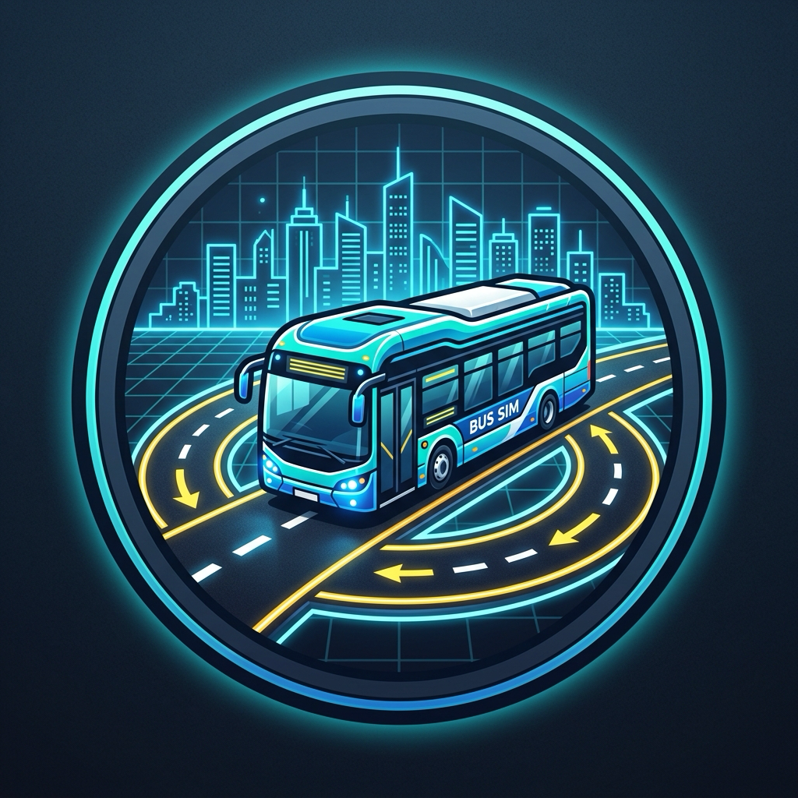

<p align="center">
  
</p>

# 2D Bus Simulator & Route Planner

<p align="center">
  <a href="#-中文说明-chinese"><b>🇨🇳 中文说明 (Chinese)</b></a> &nbsp;•&nbsp; <a href="#-english-documentation"><b>🇬🇧 English Documentation</b></a>
</p>

---

## 🇨🇳 中文说明 (Chinese)

基于 **Go 语言** 和高性能 2D 游戏引擎 **[Ebitengine](https://ebitengine.org/)** 开发的大型都市俯视角公交车模拟与线路规划游戏。

---

### 🎮 玩法特色 (Features)

1. **超大都市开放地图 (Grand Metropolitan Map)**：
   - 地图范围扩展至 **$5600 \times 3200$** 超大城市画卷。
   - 纵横分布有北环快速路、南环快速路、中央贯通大道、海滨大道、高新大道等，横跨市区运河水道、中央生态公园、金融摩天大厦区与高铁北站枢纽。
   - **12 个特色城市站点**，覆盖商业、医疗、教育、体育、交通、海港等全方位客流。
2. **多等级道路系统与动态自定义车道宽度 (Multi-Tier Roads & Customizable Lane Width)**：
   - **内置多等级道路**：包含全新双向6车道（每向3车道）城市快速路/中央干道、双向4车道主干道、双向2车道次干道、立体跨线高架等。
   - **双向6车道（每个方向3车道 / 共6车道）宏伟干线与全系统支持**：
     - **都会核心 (Metropolis CBD)**：北环快速路全面扩建为双向六车道快速路 (`北环六车道快速路`)。
     - **海滨港湾 (Coastal Bay)**：港城中央大道与跨海湾长堤大桥全面升级为双向六车道景观大道与跨海特大桥 (`港城中央六车道大道`、`跨海湾长堤六车道大桥大道`)，跨海大桥桥面同步拓宽至 140px。
     - **溪谷江城 (River Valley)**：高铁新城大道、世纪悬索长江特大桥及其南北引道全线升级为双向六车道 (`高铁新城六车道大道`、`世纪悬索长江六车道大桥`、`东大桥北/南引道`)，跨江大桥桥面拓宽至 140px。
     - **高新双城 (Twin Districts)**：中央跨区高架快速路升级为双向六车道立体快速廊道 (`中央跨区高架六车道快速路`)，跨区高架桥面拓宽至 140px。
     - **自定义地图 (Custom Map)**：完整支持在 `custom_map.json` 中配置 `lanes: 6`，默认星光北环大道升级为六车道大道。
     - **全方位配套设施**：双实黄线中央隔离带 + 每向双白色虚线车道线；路口地面导向标线全面升级为三车道配置（Lane 0 左转、Lane 1 直行、Lane 2 直行与右转）；交通信号灯悬臂横梁加长并悬挂 3 组独立信号灯头；电子警察门架横跨 6 车道并布设 4 组抓拍相机；社会车辆在 3 条车道内均衡分布巡航。
   - **动态车道宽度**：支持在 ESC 设置中实时自定义 42px / 52px / 64px / 78px 车道宽度。
3. **顺行靠右停靠与智能道路定向导航 (Right-Hand Stops & Directed Route Planning)**：
   - **靠右顺行靠站规则**：公交车乘客门设于车身右侧，所有公交站台均设在道路行车方向的右侧外缘。公交车必须顺向靠右驶入停靠港湾方可开门上下客。
   - **智能有向路网规划**：无论玩家规划任意两个站点，系统都会在城市有向路网中计算最佳合规路线，保证到达每个站点时**始终沿着该站点的顺行方向由右侧进站**。
   - **实时路段导航箭头**：车头前方导航指示箭头实时导向下一段道路的正确行驶方向。
4. **道路软硬阻隔体系与车况损伤机制 (Road Shoulder & Hard Barrier Collisions)**：
   - **正常沥青路面 (Road Core)**：最高时速自由驰骋；
   - **软路肩缓冲带 (Soft Shoulder, 40px)**：路缘外侧留有缓冲带，开上去后受路面滚动阻力减速，仪表盘点亮橙色 `[ 路肩缓冲减速 ]` 标识；
   - **防撞硬阻隔与城市实体墙 (Hard Barrier & Rebound)**：撞击护栏或建筑物触发真实物理反弹推回与震颤，扣除车况耐久并罚款 `-$100`。
5. **三大视角摄像机系统 (Three Camera Perspectives: 车头朝上跟随 / 固定正北标准 / 固定正南倒置)**：
   - **车头朝上跟随视角 (Heading-Up / Chase View)**：车头始终朝上，视野随转弯自然旋转，配备动态前瞻；
   - **固定正北标准视角 (North-Up / Classic View)**：上北下南固定视角；
   - **固定正南倒置视角 (South-Up / Inverted View)**：上南下北固定倒置视角；
   - 随时按快捷键 **`V`** 切换视角，顶部 HUD 状态栏常驻视角按钮。
6. **六大完全独立城市地图系统与全面扩展 (Six Distinct City Maps & Expansion)**：
   - **完全独立的地理风貌与高密度路网拓扑，拒绝单一壁纸贴图**：
     - **01 都会核心 (Metropolis CBD)**：经典棋盘高密度快速干道，中央运河双子桥与喷泉环岛，12 座大都市客运枢纽；
     - **02 海滨港湾 (Coastal Bay)**：由 13 条扩展至 **22 条纵横立体干道**，黄金海岸线、滨海观景大道与高密度港口物流路网，1200m 跨海悬索特大桥、海滨栈道与离岸深水保税港（**全面扩充至 12 座海滨特色大站**）；
     - **03 溪谷江城 (River Valley)**：由 16 条扩展至 **25 条山水路网**，360px 长江大峡谷天然天堑水系，北岸山城与南岸新城立体拓扑，跨江斜拉特大双桥、立体沿江大道与山岳观景干道（**全面扩充至 12 座立体客运站**）；
     - **04 湖岛水乡 (Emerald Lake)**：由 14 条扩展至 **18 条环湖与水乡航道网**，3200×1800 巨型天然翠湖与环湖高等级公路，湖心绿岛古镇、四方长堤与汉白玉石拱桥群，通航河网交错（**全面扩充至 12 座水乡名胜站**）；
     - **05 高新双城 (Twin Districts)**：由 12 条扩展至 **22 条高新干道**，临空智造与硅谷软件东西双城，中央跨区高架快速路、中央生态湿地、与规范级**立体跨线立交桥 (Grade-Separated Overpass)**（**全面扩充至 12 座高新智造站**）；
     - **06 自定义地图 (Custom Map)**：全新**用户自定义地图引擎**，直接从 `custom_map.json` 动态加载自建路网、站点、桥梁、水系与环岛，支持游戏内**一键热重载**！
7. **真实土木工程规范立体跨线桥与桥梁体系 (Civil-Engineering Grade-Separated Overpasses & Bridges)**：
   - 彻底摒弃不符合常理的锯齿多边形和怪异折线立交，遵循现代公路工程规范，设计平直顺畅的立体跨线立交与高架廊道。
   - 桥面带有真实立交阴影（Drop-Shadow）、混凝土铺装层、双侧黄黑安全防撞护栏与桥下支撑桥墩。
8. **交互式主菜单与 6 大城市选择系统 (Interactive Main Menu & City Selection)**：
   - 启动游戏进入大都市主菜单，提供 6 大城市的独立预览卡片、城市特色说明与专属站点信息。
   - 支持键盘方向键 `[← / →]`、数字键 `[1-6]` 或字母 `[C]` 选择城市，回车键 `[Enter]` 或鼠标点击进入选定城市运营。
   - 驾驶中需要更换地图时，点击顶部 HUD `[🏠 主菜单/换图]` 按钮或在 `ESC` 设置面板点击 `[🏠 返回主菜单 (选择地图)]` 优雅返回主菜单进行切换。
9. **用户自定义地图系统与免重启热重载 (Custom Map System & Hot-Reloading)**：
   - **配置文件**：项目根目录下的 `custom_map.json`，纯 JSON 格式，开箱即用。
   - **一键热重载 (Hot-Reload)**：在游戏主菜单或自定义地图中，**随时按下快捷键 `R`** 即可即时从磁盘重新载入并重绘地图，无需重启游戏！
   - **完备的校验体系**：内置轴向正交性校验、站点唯一性检测与几何尺寸有效性验证，若 JSON 存在拼写或坐标偏差会精准提示友好错误信息。
   - **内置预设模版**：游戏自带三套高标准定制模版（`星轨未来之城`、`云海群山溪谷`、`金滩半岛海港`），可随时替换使用。
10. **双重模式无缝切换 (Dual Mode Gameplay)**：
    - **驾驶模式 (Drive Mode)**：以平滑跟随时速的俯视角亲自驾驶公交车，完成进站停靠、上下客运营、赚取票价。
    - **线路规划模式 (Plan Mode)**：上帝视角全览城市路网，支持更深度的视野缩放与平移，鼠标点击站点自主连接公交线路。
11. **拟真车辆动力学、红绿灯与公平责任体系 (Kinematics, Traffic Lights & Fair Liability)**：
    - 真实的公交车前后轴距物理模型，转向拥有内轮差与后轮循迹感，前轮转向角可视化呈现。
    - 动态根据当前城市的真实道路与路口生成交通信号灯、停止线与电子警察监控。
    - AI 私家车智能避让停止中的公交车；非玩家全责碰撞免予扣款；严格执行真实交规抓拍判定。
    - **非用户车辆死锁超时防卡死预防机制 (Anti-Deadlock Prevention)**：当一个区域内，两个非玩家车辆相互顶住停滞、无法动弹超过一轮红绿灯周期（$\ge 38$ 秒）时，判定为不可自愈的死锁卡死 bug，触发预防保护直接消除卡死车辆，彻底打破僵局并恢复车流通畅；玩家大巴前后的正常行车等待受到严格豁免保护，绝不会触发车辆消失。
12. **AI 自动巡航驾驶系统与灵活飞站机制 (AI Autopilot & Smart Skip Stop)**：
    - **玩家公交车 AI 代驾**：玩家可随时将车辆完全托管给 AI 系统！AI 会精准沿规划路线循迹巡航，遇到红灯自动于停止线前平稳停车，遇前车或社会车辆自动跟车制动。
    - **精准靠站与上下客全流程托管**：接近站点时减速顺向驶入右侧黄色停靠港湾并校正车身，停稳后自动切空挡开门上下客、计算停留候客时间，关门后自动切前进挡平稳发车驶向下一站。
    - **进阶飞站机制 (Skip Stop)**：满足以下任一条件且**车内无乘客按铃下车**时，可直接飞站跳过下一站：
      1. 前方站台**无候车乘客**；
      2. 前方站台**已有其他车辆（AI公交车或社会车辆）在停靠靠站**（即使站台有候车乘客，也可直接飞站提速）。
      - 支持快捷键 **`[F]`** 手动飞站、高速驶过时**自动飞站**，以及 AI 巡航托管下的**自主智能飞站**！
    - **大路口左转红绿灯精准合规 (Major Intersection Left-Turn Compliance)**：彻底解决 AI 在 4 车道/6 车道等大路口左转闯红灯问题。AI 巡航在接近路口前精准感知交叉口导向车道与路径出弯走向，即使直行绿灯亮起，只要左转红灯箭头未熄灭，大巴均严格于左转车道停止线前平稳刹停；杜绝因提前变道微调误判为右转而发生红灯豁免穿行的问题。
    - **随时开启与关闭**：按下快捷键 **`P`**、点击仪表盘右侧 **`[🤖 AI巡航(P)]`** 按钮或在 ESC 设置面板中自由切换。
13. **多路线独立 AI 公交车队管理 (Configurable Route AI Bus Fleets)**：
    - **城市公交网络多车同台**：除了玩家驾驶的公交车外，城市路网上支持部署多条线路的 AI 公交车（1号线、2号线、3号线）。
    - **自由配置每条路线车队规模**：在 ESC 设置面板中，可将路线车队设置为 0 ~ 8 辆 AI 公交车。
    - **高辨识度专属涂装与车顶 LED 站牌**：AI 公交车配备 8 款专属定制涂装（翡翠绿、琥珀橙、紫罗兰、碧空青、樱花粉、钴蓝、亮金、薄荷青蓝等），头顶常驻高亮 LED 路线标牌（如 `[1号线] AI#1 👥12人`），并在城市站点独立交换候车乘客，营造繁荣真实的都市公交网络！
14. **中英双语界面与即时切换 (Bilingual Chinese/English UI)**：
    - 完整支持**简体中文**与 **English** 双语界面。
    - 主菜单、驾驶仪表盘、HUD 状态栏、站点名称、设置菜单与操作提示实时翻译。
    - 支持随时按下快捷键 **`L`**、点击主菜单右上角语言按钮，或在 ESC 设置面板第 8 项即时无缝切换。

---

### 🕹️ 操作指南 (Controls)

| 按键 / 操作 | 主菜单 (Main Menu) | 驾驶模式 (Drive Mode) | 线路规划模式 (Plan Mode) | 功能说明 |
| :--- | :--- | :--- | :--- | :--- |
| **ESC** | - | 打开 / 关闭游戏设置面板 | 打开 / 关闭游戏设置面板 | 切换设置弹窗 |
| **TAB** | - | 切换至线路规划模式 | 返回驾驶模式开始运营 | 模式切换 |
| **L** | **切换界面语言 (中文 / English)** | **切换界面语言 (中文 / English)** | **切换界面语言 (中文 / English)** | 语言即时切换 |
| **P** | - | **开启 / 关闭 AI 自动驾驶巡航** | 开启 / 关闭 AI 自动巡航预设 | AI 自动驾驶切换 |
| **B** (或 **Shift+P**) | - | **切换 AI 狂暴模式 (直行狂飙/双车道变道超车，遵守交规)** | 预设狂暴极速模式 | 自动驾驶极速模式 |
| **Shift+B** | - | **循环切换公交最高限速 (60 ➔ 80 ➔ 100 ➔ 120 km/h，手动与狂暴均生效)** | 极速挡位循环切换 | 最高限速调节 |
| **1 ~ 6** | 快速选中对应 1~6 号城市卡片 | - | - | 快速选择地图 |
| **C** | 快速选中【06 自定义地图】 | - | 清空当前规划路线 | 选自定义图 / 重置路线 |
| **Z** / **退格 (Backspace)** / **Del** | - | - | **撤销/取消刚添加进路线的最后一个站点** | 撤销上一个站点避免重画 |
| **R** | **热重载 custom_map.json** | **热重载 custom_map.json** (自定义地图下) | - | 实时重新载入自定义地图 |
| **A / D** 或 **← / →** | 切换上一个 / 下一个城市卡片 | 左右方向盘转向 (Steer) | 地图向左 / 向右平移 | 转向与卡片切换 |
| **Enter** / **空格** | 进入选定城市开始运营 | 紧急手刹 (Handbrake) | - | 开始运营 / 驻车制动 |
| **V** | - | **切换视角**：【正北固定】 ➔ 【车头跟随】 ➔ 【正南固定】 | 切换返回驾驶时的预设视角 | 摄像机视角切换 |
| **W / ↑** | - | **油门踏板 (Accelerator)**：驱动车辆前进（D档）或倒车（R档） | 地图向上平移 | 动力踏板 |
| **S / ↓** | - | **脚刹踏板 (Foot Brake)**：行车减速刹车至0，绝不倒车 | 地图向下平移 | 制动踏板 |
| **Shift** / **Ctrl (或 Q)** | - | **升档 / 降档 (Shift Up / Down)**：循环切换 R ➔ N ➔ D 档位 | - | 变速箱换挡 |
| **N** / **G** | - | **直接挂挡**：切入 空挡 (N) / 前进挡 (D) | - | 快速切挡 |
| **E** | - | 进站开门 / 关门发车 (Toggle Doors) | - | 上下客锁止 |
| **F** | - | 站内无人或**站台已有车靠站**且无下车铃时**飞站 (Skip Stop)** 跳过下一站 | - | 跳站提速 |
| **鼠标左键** | 点击城市卡片、开始按钮或语言切换 | 点击仪表盘档位、[🤖 AI巡航 / ⚡ 狂暴AI]、顶栏按钮 | 点击站点加入路线 / 拖拽平移地图 | 界面交互 |
| **鼠标滚轮** | - | - | 放大 / 缩小城市地图视角 | 缩放视口 |

---

### ⚙️ 游戏设置项 (Settings)

按 **`ESC`** 可随时呼出设置菜单：
1. **返回主菜单 / 更换城市**：点击 `[🏠 返回主菜单 (选择地图)]` 退入主菜单切换不同城市。
2. **红绿灯违章抓拍与罚款机制**：点击切换 `【已开启 (扣$50)】` 或 `【已关闭 (无罚款)】`。
3. **AI 私家车交通流密度**：点击切换 `低密度 (12辆)` / `中等密度 (24辆)` / `高密度 (36辆)` / `超高密度 (72辆)` / `极限车流 (128辆)`。
4. **驾驶摄像机视角 (Camera View)**：点击切换 `【固定正北 (标准)】` / `【车头朝上 (跟随)】` / `【固定正南 (倒置)】`。
5. **玩家公交 AI 自动驾驶与狂暴模式**：点击循环切换 `【👤 手动驾驶: 关闭】` ➔ `【🤖 AI自动驾驶: 标准巡航】` ➔ `【⚡ AI自动驾驶: 狂暴极速】`（快捷键 `P` 启闭，`B` 切换狂暴）。狂暴模式下直行最高车速飙升至 **80 KM/H ($445\text{px/s}$)**，支持**遇黄灯直接全速冲过（闯黄灯通行不刹停且免罚款）**；且在多车道干道支持**超远距离提前自主变道超车**：距前车 **$380\sim 640\text{px}$** 便已提前规划并敏捷并线，拒绝贴身尾随或刹停顿挫；采用全新**五次/三次 Hermite S型缓动（SmootherStep）动态横向变道算法**（横向变道速率大幅提至 $65\sim 95\text{px/s}$ 并具零加速度平滑过渡），尤其是 6 车道干道从行车道并入左转车道配置 **$350\sim 450\text{px}$** 超长自然柔和 S 曲线渐变段，彻底告别直角急甩与速度骤降，变道姿态如丝般顺滑；全城路口间距延长约 3 倍（`MapGridScale = 3.0`），长街区为极速行驶与变道超车提供超长直道舞台；弯道与红灯避障依然智能减速停稳。同时所有模式下均支持**自适应路口间距的智能提前左转变道**。
   - **公交最高限速统一设置 (手动极速 / 狂暴模式一致生效)**：提供 **60 / 80 / 100 / 120 KM/H** 四档最高限速（默认 80 KM/H）。无论是玩家**手动驾驶全油门极速狂奔**，还是 **AI 狂暴模式直行飞驰**，均共享并严格遵循该限速档位；可在设置面板直接点选或在驾驶时按 **`Shift+B`** 随心秒切。
   - **超车安全变回与防撞回退机制**：彻底根除“还未完全超过就急于变回导致碰撞”的物理缺陷，在变回原车道前强制执行**严密纵向安全距离校验**（要求被超车辆完全落入大巴车尾后方至少 **$75\text{px}$** 缓冲净空，且原车道前后死角 $100\%$ 无障碍物），变回并线全程保持极速巡航不发生刹车顿挫；变回途中若原车道突发险情可即刻安全反向回切至超车道避险。
   - **六车道（单向三车道）直行自适应车道选择**：当大巴在每方向 3 车道的 6 车道干道直行通过路口时，狂暴模式不再死板地强制并回最右侧车道（原偏移 0.0），而是实时评估两个直行车道（中间内侧直行道偏移 `-lw` 与外侧直行道偏移 `0.0`）的前方排队车流与红灯拥堵分，智能选择或保持在车少通畅的直行道全速通过路口，直行绿灯通行无阻。
6. **线路 AI 公交车队配置 (除玩家车外)**：点击循环调节 `【AI公交车队: 0~8 辆】`，即时在城市路网中调度和运行 AI 公交车队（其他 AI 车保持标准模式）。
7. **界面语言 / Language**：点击切换 `【🌐 简体中文 (Chinese)】` 或 `【🌐 English (英文)】`，游戏内全界面即时生效（快捷键 `L`）。

---

### 🚦 交通信号灯与路口行驶机制 (Traffic Lights & Intersection Rules)

1. **全城道路与路口全面加宽，大幅降低转弯难度 (Enlarged Roads & Intersections for Easy Turns)**:
   - **全城道路全面扩宽**：默认标准车道由 $42\text{px}$ 增加至 **$52\text{px}$** (+24%)，2车道道路物理宽度扩至 $116\text{px}$，4车道大道物理宽度扩至 $232\text{px}$，配合 $40\text{px}$ 缓冲路肩，为 $36\text{px}$ 宽大型公交车提供极充裕的行车余量与变道空间。
   - **路口转向沥青广场极大化**：全城所有十字路口增设 **$318\text{px} \times 318\text{px}$ 以上** 的开阔平整转弯沥青广场，消除路口内部任何错位或杂乱线段。
   - **护栏大开档距与转向零阻碍保护**：硬质防撞护栏开口半径（`gapRadius`）由 $135\text{px}$ 扩展至 **$185\text{px}$ 以上**；路口转向豁免半径（`interTurnClearance`）由 $120\text{px}$ 扩展至 **$180\text{px}$**，确保无论大巴车是内切小转弯还是外甩大转弯，尾部外摆绝不磕碰护栏。
   - **公交车转向敏捷度提升**：大巴车最大前轮转向角提升至 $39^\circ$（转弯半径由 $81\text{px}$ 缩小至 $74\text{px}$），方向盘响应速度加快，转弯操作极为丝滑轻松。
2. **红绿灯毛玻璃特效显示背景 (Frosted Glass / Glassmorphism UI)**:
   - 驾驶室 HUD 前方信号状态卡片与世界内红绿灯头均引入**高质感毛玻璃 (Glassmorphism)** 视觉效果：
     - 多层半透明深石板色底衬 (`RGBA(15, 23, 42, 195)`) 与环境投影；
     - 顶部镜面反光高光与精致内发光边缘描边 (`RGBA(255, 255, 255, 70)`)；
     - 信号灯圆形透镜带有漫反射光晕（Bloom Halo），数字与状态指示层次分明、极具未来都市沉浸感。
3. **红绿灯闯红灯严格后轮过线判定与红灯右转合法 (Rear-Wheel Stop Line Crossing & Legal Right Turn)**:
   - **闯红灯抓拍严格以后轮过线为准**：遵照现实交规“三张照片”标准，车头越线但能及时刹停（后轮未过线）绝不视为闯红灯；**只有在对应方向车道后轮越过停止线进入路口**且未右转时，才正式抓拍闯红灯。
   - **红灯右转合法通行豁免**：遵照道路交通规范，红灯期间车辆右转合法通行，系统主动赋予合法通行豁免，绝不扣除罚金。
4. **不按导向车道行驶判定与单车道/右转完全合法规则 (Exit-Side Lane Discipline & Single-Lane Legality)**:
   - **单车道道路混行与绝对合法**：在 2 车道道路（各行车方向仅 1 条车道）上，该车道为直行/左转/右转混合车道，**绝不实行导向车道违章抓拍**；车辆在单车道道路右转、直行、左转完全合法。
   - **右转通行绝对合法**：车辆在单车道道路或多车道干道的外侧车道（Lane 1，直行与右转车道）右转 100% 合法，系统绝不误判为在左转车道右转。
   - **路口内部绝不提前误判**：玩家在左转车道起步、向路口中央行驶及打方向转弯过程中，系统**绝不在路口中间提前误判直行**。
   - **到达对侧正式定性**：只有在**确实具备独立左转专用道的多车道主干道**入口，且车辆**实际到达对侧出路口线**时，系统才依据最终行驶方向进行权威判定：
     - 若在多车道大道的左转专用道（Lane 0）直行穿越对侧线或强行右转 $\implies$ 抓拍：`[交通违章抓拍] 车辆在交叉口不按导向车道行驶（左转车道违规直行/右转）！`；
     - 若在多车道大道的直行车道（Lane 1）强行左转至横向道路且左转灯为红灯 $\implies$ 抓拍：`[交通违章抓拍] 车辆在交叉口不按导向车道行驶（直行车道违规左转）！`；
     - 正常完成左转、直行或右转通过绝不罚款。
5. **直行路段电子警察监控与逆行抓拍 (Straight Road Cameras & Wrong-Way Enforcement)**:
   - **监控摄像头龙门架**：在中央主干大道、城市中轴大道、南北环快速路等直行路段设立多座钢结构监控龙门架，配备黑黄安全立柱、双向监控探头箱、慢频脉冲蓝光指示灯与路面“📸 电子监控”喷漆标线。
   - **逆行抓拍与闪光特效**：若车辆在监控摄像头检测范围内**逆向行驶（逆行）**，摄像头将触发逼真的白光闪光灯暴闪（Strobe Flash），并抓拍记录违章：`[交通违章抓拍] 车辆在【XXX】监控路段逆向行驶（逆行抓拍）！`，扣除罚金（$-\$50$）（同样受设置罚款开关控制）。
6. **斑马线专属红绿灯位与朝向清晰化 (Zebra-Crossing Aligned Traffic Lights)**:
   - 红绿灯不再散乱分布在路口内部，而是**直接设立在各方向斑马线与停止线所在的人行道与车道上方**。
   - 每个来车方向在抵达斑马线前，正前方视野即对应本方向专属信号灯杆与悬臂桁架，绝不产生方向混淆。
7. **大路口单独左转红绿灯与专用转弯车道 (Dedicated Left-Turn Signals & Turning Lanes)**:
   - **4车道城市干道大路口**（北环路、南环路、中央大道、中轴大道等）配备**8相位独立左转控制**（直行绿灯 ➔ 直行黄灯 ➔ 左转绿灯 ➔ 左转黄灯 ➔ 次向直行...）。
   - **对应转弯车道与地面标线**：
     - **内侧车道**：左转专用车道，路面清晰涂刷白色 **↰ 左转导向箭头**；
     - **外侧车道**：直行车道，路面清晰涂刷白色 **↑ 直行导向箭头**；
     - **实线禁变道标线**：进入停止线前 120px 设有白色实线车道分界线，规范车辆各行其道。
   - **专属方向灯头**：高架悬臂上分别悬挂带有方向剪头的左转灯头（⇦ 🔴/🟡/🟢）与直行灯头（⬆ 🔴/🟡/🟢）。
8. **AI车辆等红灯严禁压斑马线 (Clear Zebra-Crossing Buffer)**:
   - AI车辆感知停止线与红灯时，以**前保险杠**为基准平滑减速，稳定停在停止线白线后方（保持 10~14px 缓冲）。
   - 斑马线位于停止线前方 25px，AI车辆前保险杠与斑马线外沿保持 **>25px 充裕安全净空**，**绝不停在斑马线上**。
   - 已经越过停止线进入路口的车辆，严禁在斑马线或路口中央急停，必须平稳开出路口清空交汇区。
9. **合法通行路权 (Lawful Right-of-Way)**:
   - 车辆在**对应相位绿灯或黄灯**期间车头越过停止线，即获得本次路口通行的绝对路权。
   - 即使车辆在路口内转弯、减速、或在路口通行过程中信号灯转为黄灯/红灯，**绝不判定违章**。
   - 若车辆红灯时在停止线前刹停等待，对应车道绿灯亮起后正常起步加速通过，**绝不误判违章**。
10. **社会车辆避让与交通事故公平责任机制 (Fair Accident Liability & Collision Avoidance)**:
    - **智能避让停止公交车**：AI 社会车辆在检测到前方有停止的公交车时（包括红灯等待、站台上下客、路口排队），提前 200px 平滑减速，在前保险杠距离公交车车尾 $\ge 25\text{px}$ 处完全刹停；除非公交车逆向行驶（逆行），社会车辆绝不主动撞击停止的公交车。
    - **AI 巡航免责机制 (Autopilot Zero-Liability Protection)**：在开启 AI 巡航模式下，玩家处于托管观察状态，即使发生突发擦碰事故，系统绝不判定玩家“主动撞击”或扣减 $50 赔偿款，保障托管挂机体验。
    - **事故责任公平认定与免罚机制**：当公交车处于静止、合法顺行、环岛通行或被横向/进环岛未让行车辆碰撞时，判定对方全责，**免予扣除罚金（$0 罚款）**；仅在玩家手动驾驶且逆行或同向高速主动追尾社会车辆时，才判定玩家责任。碰撞后提供 2.0 秒无重复计费冷却，杜绝连环扣费。
11. **环岛无信号灯自律通行与严格让行机制 (Unsignalized Roundabout Right-of-Way & Yielding)**:
    - **取消传统红绿灯**：普通环岛（Rotary / Roundabout）作为连续自律流转交叉口，**不设置传统红绿灯灯架、红绿灯相位及停止线**。
    - **环形铺装与导向标线**：环岛采用真实沥青环形车道，配备外侧石质路缘、内圈可骑越卡车围裙（Mountable Truck Apron）以及环岛循环虚线导向分界线。
    - **进环岛让行标线与严格礼让**：各相交干道进环岛入口处施划**让行虚线**与地面**让行倒三角标线 (▽)**。所有社会车辆在进入环岛前必须严格礼让环岛内正在通行的公交车、线路 AI 车及其他车辆（在让行线外提前减速刹停，等待环岛内车流完全通过后方可汇入），严禁抢行加塞。
    - **自动驾驶环岛安全防护**：自动驾驶系统实时感知环岛入口越线及抢行车辆，配备前保险杠全方位紧急避障制动，绝不忽视入口障碍物或强行加油冲撞。
    - **自由畅行无红灯扣款**：车辆及玩家公交车在环岛内连续绕行或驶出时，享有绝对路权，绝无闯红灯违章判断或罚款。

---

### 🗺️ 自定义地图使用说明 (Custom Map Guide)

项目根目录包含标准自定义地图文件 **`custom_map.json`**。游戏启动时会自动检查并加载该文件。你可以在外部文本编辑器（VS Code、Sublime、Notepad 等）中随时编辑保存，然后在游戏内按 **`[R]`** 键实现**秒级免重启热重载**！

#### JSON 字段规范

```json
{
  "name": "自定义地图名称",
  "subtitle": "地图副标题说明",
  "style": "metropolis | coastal | river | lake | twincities",
  "roads": [
    {
      "name": "道路名称",
      "p1": [-1500, -600],
      "p2": [1500, -600],
      "lanes": 4
    }
  ],
  "stops": [
    {
      "id": 0,
      "name": "站点名称",
      "pos": [-1500, -600],
      "heading": 0.0,
      "lanes": 4,
      "color": "#3B82F6",
      "capacity": 20
    }
  ],
  "bridges": [
    {
      "name": "桥梁名称",
      "pos": [0, -600],
      "heading": 0.0,
      "length": 800.0,
      "width": 180.0,
      "style": "standard | cable | arch | overpass"
    }
  ],
  "waters": [
    {
      "name": "水系名称",
      "center": [0, 1000],
      "width": 4000.0,
      "height": 600.0,
      "color": "#0284C7",
      "shimmer": "#38BDF8",
      "is_ocean": false,
      "has_beach": false,
      "is_lake": true
    }
  ],
  "roundabouts": [
    {
      "name": "环岛广场",
      "center": [0, 0],
      "radius": 150.0,
      "inner_radius": 95.0,
      "type": "civic | lighthouse | island"
    }
  ],
  "buildings": [
    {
      "pos": [300, 300],
      "width": 160.0,
      "height": 220.0,
      "color": "#334155",
      "roof": "#1E293B"
    }
  ]
}
```

#### 注意事项与规则要求
1. **道路正交性规范**：所有道路端点 `p1` 与 `p2` 必须保持水平（`Y1 == Y2`）或垂直（`X1 == X2`），确保交通网络规则严谨、路口生成平整。
2. **路口转弯宽阔净空与护栏开口**：所有交叉路口均采用大尺寸沥青铺装与自适应护栏缺口（半径 $\ge 190\text{px}$），转弯转向与会车空间充足，护栏绝不贯穿切断路口。
3. **站点离路口安全距离规范**：所有公交站点均设置在路段中段（街区中段 Mid-block），与最近交叉路口保持 $\ge 240\text{px}$（通常 300~900px）充裕直线加速与进出港缓冲；自定义地图校验器强制要求站点距离任何路口中心至少 $\ge 150\text{px}$，避免进出站阻塞路口交汇。
4. **站点朝向与停靠**：`heading` 以弧度制表示（`0`=向东，`1.57`=向南，`3.14`=向西，`-1.57`=向北）。始发站为 `id: 0`，车辆开局将自动停靠在 `id: 0` 站点港湾内。
5. **平行道路合理街区距离规范（Urban Block Spacing）**：所有平行的双向道路之间禁止距离过近（严禁出现间距 $\le 300\text{px}$ 导致路肩、绿化带或公交停靠港湾挤压重叠的不合理规划）。各内置地图均统一规范为 $\ge 600\text{px}$ 真实城市街区黄金间距；自定义地图校验器强制要求任意两条具有纵向重叠投影的平行道路中心线间距必须 $\ge 400\text{px}$，确保街区开阔、真实合理。
6. **建筑物安全间距**：建筑物请放置在道路路面与路肩缓冲区之外（建议距离道路中心线 220px 以上）。
7. **即时热重载**：在主菜单或驾驶自定义地图时，按下键盘 **`R`** 键即可立即热更新路网；若 JSON 中存在语法错误或不符合规范，屏幕顶部将弹出友好的提示信息。

---

### 🚀 运行方法 (How to Run)

#### 1. 原生 macOS 应用程序包 (带专属高清 App 图标，推荐)

游戏支持直接构建为标准的 macOS 原生应用包 **`2D Bus Simulator.app`**。应用内嵌专属高分辨率（最高 1024×1024 Retina 级）应用图标 `AppIcon.icns`，启动后在 macOS 程序坞（Dock）、活动监视器、任务切换器（⌘ + Tab）及访达（Finder）中均呈现高清圆形微光应用徽标：

```bash
# 选项 A：构建 macOS 原生 App 并直接启动（在 Dock 中呈现高清图标）
./build.sh open        # 或 make open

# 选项 B：仅打包生成 "2D Bus Simulator.app"
./build.sh app         # 或 make app
open "2D Bus Simulator.app"  # 也可在访达 (Finder) 中双击启动！
```

#### 2. 编译并直接运行独立二进制文件

除了 macOS App Bundle 之外，游戏同样支持编译出极致精简（仅 ~14MB）、去除了调试符号的独立二进制文件：

```bash
# 选项 A：一键编译并在终端直接启动游戏
./build.sh run         # 或 make run

# 选项 B：仅编译出可执行文件 busgame，随后可随时在终端或访达中直接点击运行
./build.sh             # 或 make build
./busgame              # 直接运行编译产物

# 选项 C：原生 go build 命令编译
go build -trimpath -ldflags="-s -w" -o busgame .
./busgame
```

#### 3. 源码直接免编译启动
```bash
go run .
# 或使用:
make dev
```

#### 4. 多平台交叉编译 (macOS ARM64/Intel, Windows .exe, Linux)
```bash
# 一键编译全平台发布包至 dist/ 目录：
./build.sh cross
# 或使用:
make cross
```

#### 5. 运行测试与版本发布验收规范 (Testing & Release Qualification)

项目提供分层测试机制：**日常功能开发运行极速基础测试**，而在**向 GitHub 提交与发布新版本之前，必须运行全地图 Release Qualification 综合验收测试套件**：

```bash
# 1. 基础快速测试 (平时开发模式，秒级完成，自动跳过耗时验收)：
make test               # 或: go test -short ./...

# 2. 发布前全地图 Release Qualification 综合验收测试 (发布到 GitHub 前必跑！)：
make test-qualify       # 或: go test -v -run TestReleaseQualification ./...
# 包含：
# - 6 大城市地图多圈闭环自主营运巡航 (标准模式 + 狂暴模式)
# - 128 台社会车辆 + 8 辆 AI 公交车队超重载并发防死锁验证
# - 狂暴模式超车变道平滑度与零不必要减速动力学审计 (0.35s~0.55s 敏捷入位)
# - 6 大地图所有站点港湾与环岛道路界限防撞硬阻隔与双黄线安全合规审计
# - 中英文双语环境全地图线路站牌、换行与 HUD 布局零截断审计

# 3. 运行全量测试用例：
make test-all           # 或: go test -v ./...
```

---

### 🏷️ 版本记录与发布说明 (Release Notes)

- **v0.0.4** (当前最新):
  - **🚍 统一 45 人大容量与贪婪全员上客机制 (Greedy Boarding & Unified 45-Pax Capacity)**：
    - 针对全图单主干闭环运营机制，全面标准化玩家公交车及全线 8 辆 AI 公交车队容量为 45 人。
    - 乘客到站“能上尽上”，只要车内有空位且站台有候车乘客即全员上车，不再受选线偏好阻碍；车满即止。
    - 完美支持同站连续/多次停靠上客：在同一站台再次停靠或接续开门时，若站台有新候车乘客且车厢未满，继续响应并执行上客。
  - **📍 线路专属乘客生成与闭环下游目的地约束 (Route-Constrained Passenger Generation)**：
    - 重新规划路线（或重置开局）时，乘客仅在已规划路线停靠的公交车站台生成，未规划站点清零且不聚集候车客流。
    - 候车乘客的目的地严格约束为当前公交车路线可实际送达的下游车站，彻底杜绝生成无法到达的盲流乘客。
  - **🚦 十字路口黄网格通行净空与防占道避让 (Yellow Box Clearance / Intersection Box Protection)**：
    - AI 社会车辆新增“黄网格禁入 / Don't Block the Box”防御性驾驶感知。
    - 绿灯驶向交叉路口前，若探测到路口中央区域（Intersection Box）内有正在转弯、跨道或低速穿越的公交车，小车必须在停止线前保持制动等待，严禁在绿灯时强行冲入已被大车占满的路口中心，从源头消灭路口中央恶性死锁。
  - **⏱️ 道路死锁超时双向安全重置机制 (Severe Gridlock Timeout & Self-Healing)**：
    - 设定基于最长红绿灯周期（37秒）的超时自愈阈值 `DeadlockDurationThreshold = 38.0s`。
    - 智能区分合法车队同向排队与异常死锁对顶；若 AI 小车与 AI 公交车（或开启 AI 托管的玩家车辆）相互卡死超过 38 秒：
      - AI 小车自动消失并在全图安全空旷、远离路口与站台的直道上平滑重置复生；
      - AI 公交车/托管车辆平稳重置回线路起点站（`StopIDs[0]`），速度、转向角归零，清空滞留乘客，线路索引归零重新发车，保障城市交通流永久自治自愈。

- **v0.0.3**:
  - **🏆 全地图多轮闭环发布验收测试套件 (Release Qualification Suite)**：
    - 新增面向 GitHub 新版本发布资格认证的端到端集成测试 (`make test-qualify`)。
    - 针对全 6 张地图（都会、海滨、溪谷、翠湖、双城、自定义地图）多圈全流程自动化营运。
    - 验证 128 台民用车（密度5）与 8 辆 AI 公交车队超重载并发下的零卡死、零物理穿模与平稳调度。
    - 日常功能开发使用 `make test`（基于 `go test -short`），执行耗时 $< 1$ 秒，兼顾敏捷开发与严苛发版质量。
  - **⚡ 狂暴模式 (Berserk Mode) 超车变道动力学深度优化**：
    - 消除变道初期迟缓拖沓、减速过甚的体验问题，采用平滑三次 Hermite 偏移行车线算法。
    - 横向入位时间精准缩短至 $0.35\text{s} \sim 0.55\text{s}$，变道全过程保持 $\ge 120\text{px/s}$ 高速冲刺巡航，零不必要拖泥带水减速。
    - 修复远端弯道曲率误累加至近端长直道的历史问题，高速直道巡航更加平顺稳定。
  - **🗺️ 双向 6 车道宏伟快速廊道全面贯通**：
    - 都会核心北环六车道、海滨港湾跨海长堤六车道、溪谷江城跨江大桥六车道、高新双城跨区高架六车道全线通车。
    - 交通灯三联装横梁、4 目抓拍电子警察立杆与三车道导向标线全面标准化。
  - **🌐 中英双语路线标牌自适应排版优化**：
    - 针对超长站点名称与跨语言字符宽度，引入动态阶梯换行、换行引导箭头与末端紧凑角标，杜绝界面遮挡。

- **v0.0.2**:
  - 用户自定义地图引擎 (`custom_map.json` 与 `R` 键一键免重启热重载)。
  - 全流程 AI 巡航托管代驾与智能飞站。
  - 8 款独立 AI 公交车队独立营运。
  - 中英双语界面一键即时切换 (`L` 键)。
  - 原生 macOS 高清 Retina 应用程序包构建体系 (`AppIcon.icns` 与 `./build.sh app`)。

- **v0.0.1**:
  - 2D Bus Simulator 初始版本发布，经典都市大地图、拟真车辆动力学、红绿灯与公交线路规划。

---

## 🇬🇧 English Documentation

An expansive top-down metropolitan bus simulation and route planning game built with **Go** and the high-performance 2D game engine **[Ebitengine](https://ebitengine.org/)**.

---

### 🎮 Features

1. **Grand Metropolitan Open Map ($5600 \times 3200$)**:
   - Expansive metropolitan canvas spanning **$5600 \times 3200$** units.
   - Comprehensive arterial network including North/South Ring Expressways, Central Grand Boulevard, Coastal Highway, and High-Tech Expressway, bridging the urban canal waterways, Central Ecological Park, Financial District skyscrapers, and High-Speed Rail Hub.
   - **12 distinct urban transit stops** covering commercial hubs, medical centers, university campuses, sports complexes, transit terminals, and deep-water ports.
2. **Multi-Tier Road Hierarchy & Dynamic Lane Width**:
   - **Built-in Road Hierarchy**: Dual-carriageway 4-lane boulevards, 2-lane urban avenues, and elevated overpasses.
   - **Customizable Lane Widths**: Switch on-the-fly in ESC Settings between 42px (Compact), 52px (Standard), 64px (Boulevard), and 78px (Expressway).
3. **Right-Hand Curbside Docking & Directed Route Navigation**:
   - **Right-Hand Docking Rule**: Bus passenger doors are located on the vehicle's right flank. All transit stop bays are positioned along the right outer edge of traffic flow. The bus must align and pull into the docking bay along the proper right-hand direction to open doors.
   - **Intelligent Directed Routing**: Regardless of which stops are selected, the routing engine calculates the optimal legal path across the directed road network, ensuring the bus always approaches every station in the correct forward travel direction.
   - **Real-Time Directional Navigation Arrows**: Dynamic arrows ahead of the bus indicate the upcoming roadway's correct lane and direction.
4. **Road Shoulder Resistance & Hard Barrier Physics**:
   - **Asphalt Roadway (Road Core)**: Cruise freely at top vehicle speed.
   - **Soft Shoulder Buffer (40px)**: Driving onto outer gravel shoulders introduces realistic rolling resistance and slows the vehicle down, lighting up an orange `[ Shoulder Resistance ]` warning on the dashboard.
   - **Hard Barrier & Wall Collisions**: Crashing into roadside guardrails or buildings triggers physical rebound forces, screen shake, vehicle durability damage, and a `-$100` repair fine.
5. **Three Dynamic Camera Perspectives (Heading-Up / North-Up / South-Up)**:
   - **Heading-Up (Chase View)**: Vehicle nose always points upward; viewport smoothly rotates with turns and features dynamic look-ahead camera panning.
   - **North-Up (Classic View)**: Standard fixed top-down orientation (North is up).
   - **South-Up (Inverted View)**: Inverted fixed orientation (South is up).
   - Toggle seamlessly at any time with hotkey **`V`** or via the HUD top bar camera button.
6. **Six Completely Distinct City Maps**:
   - **Individual geographic environments and high-density road topologies (not merely background skins)**:
     - **01 Metropolis CBD**: Classic high-density grid expressway network, Central Canal Twin Bridges, fountain roundabout, and 12 grand metropolitan passenger terminals.
     - **02 Coastal Bay**: 22 arterial roads, scenic golden shoreline highway, high-density harbor logistics corridors, a 1200m suspension bridge, ocean boardwalk, and offshore bonded port (12 coastal stations).
     - **03 River Valley**: 25 mountain and riverside corridors, a massive 360px natural canyon river chasm separating North Mountain City and South New City, dual cable-stayed cross-river bridges, and multi-level mountain scenic avenues (12 multi-tiered transit stations).
     - **04 Emerald Lake**: 18 lakeside roads and navigable water channels, a massive 3200×1800 natural lake, central historical island town, marble arch bridges, and ancient water town heritage (12 lakeside scenic stations).
     - **05 Twin Districts**: 22 high-tech corridors connecting Aero-Manufacturing City with Silicon Valley Software Park, cross-district elevated highway, ecological wetlands, and civil-engineering grade-separated overpasses (12 innovation hub stations).
     - **06 Custom Map**: User-defined map engine loaded directly from `custom_map.json` with zero-downtime hot-reloading!
7. **Civil-Engineering Grade-Separated Overpasses & Bridges**:
   - Adheres to standard civil engineering road design without awkward polygon kinks or disjointed elevated ramps.
   - Overpasses feature realistic ambient drop shadows, reinforced concrete pavement decks, yellow-and-black crash barriers, and structural support piers below.
8. **Interactive Main Menu & City Selection**:
   - Launch into a polished metropolitan dashboard showcasing 6 city preview cards, distinctive regional features, and transit stop profiles.
   - Navigate with arrow keys `[← / →]`, number keys `[1-6]`, or letter `[C]`; start driving with `[Enter]` or mouse click.
   - Switch cities anytime during gameplay via the top HUD `[🏠 Main Menu]` button or ESC Settings `[🏠 Main Menu (Select City)]`.
9. **Custom Map Engine & Instant Hot-Reloading (`R` Key)**:
   - **Configuration File**: `custom_map.json` in the root directory in clean, standard JSON format.
   - **Instant Hot-Reload**: Press **`R`** anytime in the Main Menu or during custom map gameplay to reload and re-render the map instantly from disk without restarting the game!
   - **Robust Validation**: Built-in orthogonal alignment verification, stop uniqueness checks, and safe distance validation with informative diagnostic banners.
   - **Included Presets**: Three production-ready templates provided out-of-the-box (`Orbital City`, `Misty Valley`, `Golden Peninsula`).
10. **Dual-Mode Seamless Gameplay**:
    - **Drive Mode**: Experience smooth speed-adaptive top-down driving, dock at stations, open doors to board/alight passengers, and collect bus fares.
    - **Route Planning Mode**: Zoom out to a bird's-eye tactical overview of the entire transit network, panning smoothly to link passenger stations into custom bus routes.
11. **Realistic Vehicle Kinematics, Traffic Lights & Fair Liability**:
    - Authentic dual-axle bus physics with inner-wheel turn radius, rear-axle tracking, and visual front-wheel steering angles.
    - Dynamic signal timing, stop lines, and automated speed/red-light cameras generated for all intersection approaches.
    - AI traffic vehicles proactively brake and yield to stationary buses; zero-liability protection ensures players are never fined for collisions where they are not at fault.
12. **Autonomous AI Autopilot (`P` Key)**:
    - **Full AI Driving Chauffeur**: Hand vehicle controls over to AI at any time. The autopilot tracks planned route polylines, stops smoothly behind red lights and leading vehicles, and obeys lane discipline.
    - **Automated Curbside Docking**: Automatically slows down on approach, maneuvers into right-hand yellow stop bays, shifts to Neutral (`N`), opens doors, waits for passengers, closes doors, shifts to Drive (`D`), and departs.
    - **Toggle Anytime**: Press hotkey **`P`**, click the dashboard `[🤖 Autopilot(P)]` button, or toggle in ESC Settings.
13. **Configurable Multi-Route AI Bus Fleets**:
    - **Vibrant City Transit Ecosystem**: Deploy autonomous AI bus fleets across separate route networks (Line 1, Line 2, Line 3) alongside the player's bus.
    - **Configurable Fleet Size**: Adjust Line 1, Line 2, and Line 3 fleets from 0 to 4 buses each in the ESC Settings menu.
    - **Distinct Liveries & LED Headboards**: Line 1 (Emerald Green), Line 2 (Amber Orange), and Line 3 (Violet Purple) feature overhead glowing LED route displays (e.g., `[Line 1] AI#1 👥12`) and independently transport passengers between city stops.
14. **Bilingual Chinese / English Interface (`L` Key)**:
    - Comprehensive support for both **Simplified Chinese (简体中文)** and **English**.
    - Main menu, instrument telemetry, top HUD banner, bus stop titles, settings panel, and operational toasts translate instantly.
    - Toggle anytime via hotkey **`L`**, the top-right Main Menu language button, or Option 8 in the ESC Settings modal.

---

### 🕹️ Controls

| Key / Action | Main Menu | Drive Mode | Route Planning Mode | Description |
| :--- | :--- | :--- | :--- | :--- |
| **ESC** | - | Open / Close Settings modal | Open / Close Settings modal | Toggle settings dialog |
| **TAB** | - | Switch to Route Planning Mode | Return to Drive Mode | Switch gameplay mode |
| **L** | **Toggle Language (中文 / English)** | **Toggle Language (中文 / English)** | **Toggle Language (中文 / English)** | Instant language toggle |
| **P** | - | **Toggle AI Autopilot** | Toggle Autopilot default | AI autonomous driving toggle |
| **B** (or **Shift+P**) | - | **Toggle AI Berserk Mode (Fast straightaways & 2-lane overtaking, strict rules)** | Preset Berserk Mode | Fast straightaway mode |
| **1 ~ 6** | Select City Cards 1 to 6 | - | - | Quick map selection |
| **C** | Select [06 Custom Map] | - | Clear currently planned route | Select custom map / Reset route |
| **Z** / **Backspace** / **Del** | - | - | **Undo / Remove last stop added to route** | Undo stop without replanning |
| **R** | **Hot-reload custom_map.json** | **Hot-reload custom_map.json** (in Custom Map) | - | Reload custom map from disk |
| **A / D** or **← / →** | Previous / Next city card | Steer steering wheel left / right | Pan map left / right | Steering & card navigation |
| **Enter** / **Space** | Start driving selected city | Emergency Handbrake | - | Start game / Parking brake |
| **V** | - | **Cycle Camera View**: [North-Up] ➔ [Heading-Up] ➔ [South-Up] | Cycle default camera view | Switch camera perspective |
| **W / ↑** | - | **Throttle (Accelerator)**: Accelerate forward (in D) or reverse (in R) | Pan map upward | Power pedal |
| **S / ↓** | - | **Foot Brake**: Decelerate to 0 km/h (never reverses) | Pan map downward | Service brake pedal |
| **Shift** / **Ctrl (or Q)** | - | **Shift Gear Up / Down**: Cycle through R ➔ N ➔ D | - | Transmission gear shift |
| **N** / **G** | - | **Direct Gear Selection**: Neutral (N) / Drive (D) | - | Quick gear shift |
| **E** | - | Open / Close Doors at bus stop (Toggle Doors) | - | Passenger door interlock |
| **F** | - | **Skip Stop**: Bypass next stop when empty and no bell | - | Speed up route service |
| **Left Click** | Select city card, Start button, or Language button | Click dashboard gears, [🤖 Autopilot / ⚡ Berserk], [🏠 Main Menu], or [View] | Click stops to build route / Drag map | UI interaction |
| **Scroll Wheel** | - | - | Zoom in / out map view | Viewport zoom |

---

### ⚙️ Settings

Press **`ESC`** at any time to open the Settings modal:
1. **Return to Main Menu / Switch City**: Click `[🏠 Main Menu (Select City)]` to return to the city selection menu.
2. **Traffic Light Cameras & Fines**: Toggle between `[Enabled (-$50 fine)]` and `[Disabled (No fine)]`.
3. **AI Private Vehicle Traffic Density**: Cycle between `Low (12 cars)`, `Medium (24 cars)`, and `High (36 cars)`.
4. **Custom Citywide Lane Width**: Cycle between `Compact (42px)`, `Standard (52px)`, `Boulevard (64px)`, and `Expressway (78px)`.
5. **Camera Perspective**: Switch between `[North-Up (Classic)]`, `[Heading-Up (Follow)]`, and `[South-Up (Inverted)]`.
6. **Player Bus AI Autopilot & Berserk Mode**: Cycle between `[👤 Manual: OFF]`, `[🤖 Autopilot: Standard]`, and `[⚡ Autopilot: BERSERK]` (hotkey `P` to toggle, `B` for Berserk). In Berserk mode, top cruise speed on straight roads is boosted to $310\text{px/s}$, with **autonomous multi-lane overtaking** of slower vehicles on 2-lane roads; corners, red lights, and station stops strictly follow traffic rules. All modes feature **intelligent, block-distance adaptive early left-turn lane merging**.
7. **Route AI Bus Fleet Sizing**: Adjust fleet numbers independently for `Line 1 [0~4]`, `Line 2 [0~4]`, and `Line 3 [0~4]` (other AI vehicles remain in standard cruise mode).
8. **UI Language / 界面语言**: Toggle between `[🌐 简体中文 (Chinese)]` and `[🌐 English (英文)]` with immediate UI refresh (hotkey `L`).

---

### 🚦 Traffic Lights & Intersection Rules

1. **Enlarged Roads & Intersections for Easy Turns**:
   - **Expanded Carriageways**: Default lane width increased to **$52\text{px}$** (+24%), with 2-lane avenues at $116\text{px}$ and 4-lane boulevards at $232\text{px}$, complemented by $40\text{px}$ soft shoulders to give $36\text{px}$-wide buses ample maneuvering clearance.
   - **Spacious Turning Plazas**: Intersections feature smooth continuous asphalt junctions measuring **$\ge 318\text{px} \times 318\text{px}$** without awkward interior seam lines.
   - **Generous Guardrail Clearances**: Guardrail gap radius expanded to **$\ge 185\text{px}$** and turn exemption clearance set to **$180\text{px}$**, ensuring long buses never scrape guardrails during wide or sharp turns.
   - **Agile Steering Geometry**: Front steering angle reaches $39^\circ$ (turning radius reduced to $74\text{px}$) with rapid wheel return dynamics for responsive control.
2. **Glassmorphism Signal Displays**:
   - HUD signal indicators and in-world traffic lights feature frosted-glass aesthetics:
     - Semi-transparent dark slate backgrounds (`RGBA(15, 23, 42, 195)`) with soft ambient drop shadows.
     - Top-edge specular highlights and inner glow borders (`RGBA(255, 255, 255, 70)`).
     - Diffuse bloom halos around signal lenses with legible countdown numbers.
3. **Rear-Wheel Stop Line Crossing & Legal Right Turns**:
   - **Rear-Wheel Crossing Standard**: Following real-world three-photo enforcement standards, overshooting the stop line slightly but braking before rear wheels cross is never penalized. Enforcement triggers only when the rear axle crosses into the intersection against a red signal.
   - **Legal Right Turn on Red**: Vehicles executing legal right turns on red signals receive automatic exemption with zero penalty.
4. **Lane Discipline & Single-Lane Legality**:
   - **Single-Lane Roads (Mixed Flow)**: On 2-lane roads (1 lane per direction), the single lane accommodates straight, left, and right movements without lane-discipline restrictions.
   - **Legal Right Turns**: Right turns from outer lanes (Lane 1) are always 100% legal.
   - **No Premature Violations Inside Intersections**: The system never penalizes vehicles while executing turns in the middle of junctions.
   - **Exit-Side Verification**: Violations only trigger when exiting multi-lane approaches into opposing lanes against designated turn arrows.
5. **Gantry Speed & Wrong-Way Enforcement Cameras**:
   - **Steel Surveillance Gantries**: Positioned on major arterial avenues with yellow/black hazard pillars, dual surveillance enclosures, pulsing blue beacons, and road markings.
   - **Wrong-Way Strobe Flash**: Driving against traffic within camera zones triggers a realistic white strobe flash, records an infraction banner (`[Traffic Violation] Vehicle traveling against traffic direction!`), and assesses a $-\$50$ fine (respects settings toggle).
6. **Zebra-Crossing Aligned Signals**:
   - Traffic signals are mounted on overhead gantries directly aligned with each approach's pedestrian crossing and stop line, ensuring clear visibility.
7. **Dedicated Left-Turn Signals & Turning Lanes**:
   - 4-lane boulevards feature 8-phase signal controllers with dedicated left-turn green arrows.
   - Inner lanes (Lane 0) display painted **↰ Left-Turn Arrows**, outer lanes display **↑ Straight Arrows**, and solid white lines prevent last-second weaving.
8. **Clear Zebra-Crossing Buffer for AI Traffic**:
   - AI vehicles decelerate smoothly to maintain $\ge 25\text{px}$ buffer clearance before pedestrian crossings, never halting across crosswalks.
9. **Lawful Right-of-Way**:
   - Vehicles entering an intersection during green or yellow phases retain lawful right-of-way until clearing the junction.
10. **Fair Accident Liability & Collision Avoidance**:
    - AI private vehicles detect stopped buses up to 200px ahead and brake to a complete stop $\ge 25\text{px}$ away.
    - **Autopilot Zero-Liability**: While in AI Autopilot mode, players are never penalized for unforeseen traffic collisions.
    - **Fair Liability Assessment**: Being rear-ended or struck by failing-to-yield traffic results in zero fines ($0). Penalties apply only if manually driving against traffic or rear-ending other vehicles at high speed. A 2.0s cooldown prevents cascade billing.
11. **Unsignalized Roundabout Right-of-Way & Strict Yielding**:
    - Roundabouts operate without traffic lights or stop lines.
    - Approaching traffic must yield at yield triangles (▽) to all vehicles circulating inside the roundabout.
    - Autopilot includes emergency obstacle avoidance for aggressive merge vehicles.

---

### 🗺️ Custom Map Guide

The project includes a standard `custom_map.json` file in the root directory. You can edit it with any text editor and press **`[R]`** in-game for instant, zero-downtime hot-reloading!

#### JSON Schema Reference

```json
{
  "name": "Custom City Name",
  "subtitle": "Subtitle description",
  "style": "metropolis | coastal | river | lake | twincities",
  "roads": [
    {
      "name": "Avenue Name",
      "p1": [-1500, -600],
      "p2": [1500, -600],
      "lanes": 6
    }
  ],
  "stops": [
    {
      "id": 0,
      "name": "Stop Name",
      "pos": [-1500, -600],
      "heading": 0.0,
      "lanes": 6,
      "color": "#3B82F6",
      "capacity": 20
    }
  ],
  "bridges": [
    {
      "name": "Bridge Name",
      "pos": [0, -600],
      "heading": 0.0,
      "length": 800.0,
      "width": 180.0,
      "style": "standard | cable | arch | overpass"
    }
  ],
  "waters": [
    {
      "name": "Water Body Name",
      "center": [0, 1000],
      "width": 4000.0,
      "height": 600.0,
      "color": "#0284C7",
      "shimmer": "#38BDF8",
      "is_ocean": false,
      "has_beach": false,
      "is_lake": true
    }
  ],
  "roundabouts": [
    {
      "name": "Roundabout Name",
      "center": [0, 0],
      "radius": 150.0,
      "inner_radius": 95.0,
      "type": "civic | lighthouse | island"
    }
  ],
  "buildings": [
    {
      "pos": [300, 300],
      "width": 160.0,
      "height": 220.0,
      "color": "#334155",
      "roof": "#1E293B"
    }
  ]
}
```

#### Rules & Verification Constraints
1. **Orthogonal Road Alignment**: Endpoints `p1` and `p2` must be horizontal (`Y1 == Y2`) or vertical (`X1 == X2`) to produce clean geometric intersections.
2. **Generous Intersection Clearances**: Guardrail gaps ($\ge 190\text{px}$) and asphalt plazas allow wide bus turns without rail clipping.
3. **Stop Distance from Junctions**: Stops must be located mid-block, at least $\ge 150\text{px}$ (ideally 300~900px) away from any intersection center.
4. **Stop Heading & Departure**: `heading` is in radians (`0`=East, `1.57`=South, `3.14`=West, `-1.57`=North). Stop `id: 0` is the starting depot where the bus spawns.
5. **Urban Block Spacing**: Parallel roads must maintain a centerline spacing of at least $\ge 400\text{px}$ ($\ge 600\text{px}$ recommended) to avoid overlapping shoulders or docking bays.
6. **Building Placement**: Place buildings outside road shoulders (recommended $\ge 220\text{px}$ from road centerlines).
7. **Hot-Reload**: Press **`R`** to reload the map instantly. Any JSON validation issues will display informative diagnostics in the top banner.

---

### 🚀 How to Run

#### 1. Native macOS Application Bundle (Recommended)

Build directly as a standard macOS application bundle **`2D Bus Simulator.app`** with high-resolution Retina app icon `AppIcon.icns`:

```bash
# Option A: Build and launch directly (displays high-res icon in Dock)
./build.sh open        # or: make open

# Option B: Bundle "2D Bus Simulator.app" without opening
./build.sh app         # or: make app
open "2D Bus Simulator.app"  # or double-click in Finder!
```

#### 2. Standalone Binary Executable

Compile a lightweight (~14MB) standalone binary stripped of debug symbols:

```bash
# Option A: Build and launch from terminal
./build.sh run         # or: make run

# Option B: Compile executable 'busgame'
./build.sh             # or: make build
./busgame              # Run executable directly

# Option C: Standard Go build command
go build -trimpath -ldflags="-s -w" -o busgame .
./busgame
```

#### 3. Run Directly with Go
```bash
go run .
# or:
make dev
```

#### 4. Multi-Platform Cross-Compilation (macOS ARM64/Intel, Windows .exe, Linux)
```bash
# Cross-compile release packages into dist/:
./build.sh cross
# or:
make cross
```

#### 5. Testing & Release Qualification Workflow

The project provides a tiered testing architecture: **routine feature development runs lightning-fast unit tests**, while **the comprehensive multi-map Release Qualification suite must pass before any new release is published to GitHub**:

```bash
# 1. Fast Development Test Suite (runs in < 1s, skips long qualification runs):
make test               # or: go test -short ./...

# 2. Release Qualification Suite (MANDATORY before publishing releases to GitHub):
make test-qualify       # or: go test -v -run TestReleaseQualification ./...
# Covers:
# - All 6 city maps autonomous multi-lap transit (Standard & Berserk modes)
# - Maximum concurrency stress: 128 traffic cars + 8 AI bus fleet with zero deadlocks
# - Berserk overtaking lane transition audit (0.35s~0.55s snappy change, >= 120 px/s)
# - Boundary safety audit: zero hard barrier collisions across all 72 stop bays & roundabouts
# - Bilingual HUD & route line formatting with zero text clipping or overlapping

# 3. Run all unit and integration tests:
make test-all           # or: go test -v ./...
```

---

- **v0.0.4** (Current):
  - **🚍 Unified 45-Pax Capacity & Greedy Boarding**: Standardized 45-passenger capacity across player bus and all 8 AI fleet buses. Passengers board greedily on arrival as long as space remains without route divergence obstacles. Consecutive docking at the same stop continues boarding if capacity exists.
  - **📍 Route-Constrained Passenger Generation**: Passengers only spawn at stations included in the active route, with destinations strictly restricted to upcoming stops along the planned route.
  - **🚦 Yellow Box Intersection Clearance ("Don't Block the Box")**: Traffic AI cars yield before stop lines on green if an AI or player bus occupies or turns within the intersection box, preventing junction choke points.
  - **⏱️ Severe Gridlock Timeout Resolution (> 38s)**: Resolves unyielding deadlocks exceeding one full traffic light cycle (38.0s threshold). Jammed civilian cars disappear and respawn on clear road sections; jammed AI buses reset back to the route's starting terminal (`StopIDs[0]`) with cleared passengers and reset route index. Player bus in AI autopilot mode is fully protected.

- **v0.0.3**:
  - **🏆 Release Qualification Test Suite**: Automated qualification pipeline (`make test-qualify`) across all 6 city maps, multi-lap transit loops, 128 traffic cars + 8 AI bus fleets, and strict safety audits. Routine development tests (`make test`) run in $< 1$s.
  - **⚡ Berserk Mode Overtaking Optimization**: Snappy $0.35\text{s} \sim 0.55\text{s}$ lane transitions using cubic Hermite offset paths, eliminating sluggish deceleration and sustaining $\ge 120\text{px/s}$ cruise speeds during overtakes.
  - **🗺️ Six-Lane Grand Express Corridors**: Fully realized 6-lane expressways across Metropolis, Coastal Bay, River Valley, and Twin Cities with triple-head traffic lights, 4-lens electronic surveillance, and dedicated lane guide arrows.
  - **🌐 Adaptive Bilingual Route Display**: Responsive multi-line wrapping and concise summary badges for complex transit loops in both Chinese and English.

- **v0.0.2**:
  - Custom map JSON engine with in-game hot-reloading (`R`).
  - Full AI autopilot with boarding management and smart skip-stop.
  - 8-bus multi-route AI fleet.
  - Instant bilingual English/Chinese localization (`L`).
  - Native macOS application bundle with high-res Retina icon.

- **v0.0.1**:
  - Initial public release of 2D Bus Simulator & Route Planner.
