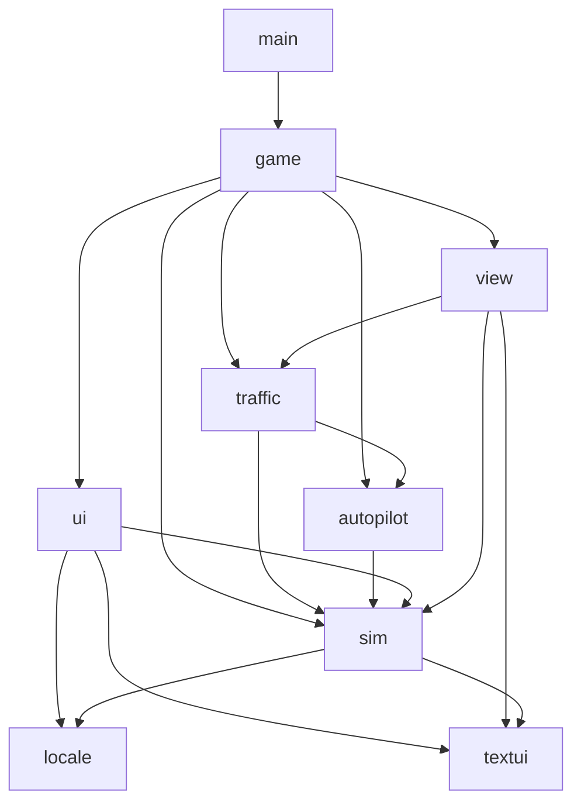

# 项目架构

`main.go` 负责窗口配置、图标和启动。`game` 包负责游戏流程，具体规则和界面由 `internal` 下的包实现。新增功能先按职责选包，避免重新堆入 `game.go`。

## 目录与职责

```text
.
├── main.go                    # Ebitengine 启动入口
├── cmd/map-preview/           # 实际渲染导出：五城总览、驾驶近景和旋转相机检查
├── game/                      # 应用编排：城市切换、输入、路线编辑、运营流程
│   ├── game.go                # Game 状态、构造、Update、Layout
│   ├── city.go                # 城市切换、自定义地图重载
│   ├── planning.go            # 规划模式交互
│   ├── route_lifecycle.go     # 路线变更、公交复位
│   ├── driving.go             # 驾驶帧更新顺序
│   ├── driver_controls.go     # 手动/自动驾驶控制输入
│   ├── driver_input.go        # 驾驶快捷键、HUD 点击
│   ├── driver_safety.go       # 道路边界、玩家自动驾驶死锁恢复
│   ├── stop_approach.go       # 进站判断、飞站、漏站
│   ├── passengers.go          # 上下客、票款、站台交互
│   ├── collisions.go          # 玩家、车队与交通车辆碰撞处理
│   ├── draw.go                # 场景绘制顺序
│   ├── menu.go                # 主菜单与内嵌菜单图标
│   └── assets/                # go:embed 使用的菜单资源
├── internal/
│   ├── sim/                   # 共享仿真状态、物理、地图、路网、信号与交规
│   ├── autopilot/             # 自动驾驶控制器、循迹、换道、进站及避障
│   ├── traffic/               # 社会车辆行为、公交车队、交通死锁恢复
│   ├── view/                  # 地图/车辆/站台/信号灯/路线绘制
│   ├── ui/                    # HUD、仪表盘、设置和规划面板
│   ├── locale/                # 中英文切换与文本选择
│   ├── textui/                # 字体加载、文本绘制与测量
│   └── testutil/              # 测试文件系统隔离
├── tests/integration/         # 跨包运营场景、全地图与发布验收
├── assets/                    # 启动图标、打包资源
├── custom_map.json            # 用户自定义地图，运行时路径保持不变
└── docs/architecture.md
```

## 包依赖



`sim` 不依赖游戏流程、车队控制器、自动驾驶控制器或场景绘制。它提供共享类型，避免地图、车辆与站台互相持有状态时出现循环依赖。路线描述需要文本宽度测量，因此仍使用叶子包 `textui`；渲染实现由 `view` 持有。

绘制函数接收仿真对象，例如 `view.DrawBus(bus, screen, camera)`。修改绘制样式进入 `view`，修改运动/道路/信号规则进入 `sim` 或相应控制器包。

## 大文件的分工

- 地图：`world.go` 管理世界与路网；`maps_roads.go`、`maps_stops.go`、`maps_scenery.go` 组织内置地图数据；`boundaries.go` 管理区域与碰撞边界。
- 路线：`route.go` 管理站点顺序和缓存；`road_graph.go` 处理路网几何；`road_search.go` 执行带朝向的图搜索；`pathfinding.go` 把搜索结果转换为驾驶路径；`roundabout_paths.go` 处理环岛弧线。
- 路口：`junction_geometry.go` 统一路口转弯半径、可行驶范围及停止线间距；公交路径、社会车辆曲线、信号灯和渲染共享该几何，扩大路口时应整体调整。`road_lane_safety.go` 在多车道路段预测公交车车身扫过范围，避免高速变道越过中线。
- 信号灯：`signals.go` 构建系统；`signal_approaches.go` 处理各方向车道；`signal_phases.go` 维护相位转移；`traffic_rules.go` 判断停车、闯灯与车道违规。
- 社会车辆：`car_update.go` 编排一帧；感知规则分别在 `car_signals.go`、`car_following.go`、`car_roundabout.go`；`car_motion.go` 分派运动；`car_roundabout_curve.go` 按行驶距离连接环岛入口、圆弧与出口，保持位置与朝向连续；`station_departure_clearance.go` 按实际车身边界判断能否经过等待出站的公交车；`recovery.go` 处理死锁和重生。
- 自动驾驶：`driver.go` 编排控制；`path.go`、`steering.go`、`speed.go` 分别处理循迹、转向和限速；站台、交叉口、环岛、超车各有明确入口；`station_bypass.go` 维护飞站时的道路轨迹、当前车道与下一段路线的连续衔接；`station_departure_traffic.go` 在并出站台前检查车道间隙，并检查部分并入后的车身扫过范围；`roundabout.go` 负责外侧保持与内侧提前安全并线，不在环岛内启动超车；`roundabout_direct_exit.go` 检查内侧车辆连续驶出时的动态车身扫过范围与转弯半径；`roundabout_exit.go` 在无法安全驶出时保留目标出口并补绕一圈。
- 界面：`hud.go` 处理 HUD 状态和点击；`dashboard.go`、`planning.go`、`settings_draw.go` 负责对应面板。

## 行为与维护约束

1. `Game.Update` 的仿真顺序保持为信号灯、社会车辆、公交车队、交规/碰撞、乘客生成、当前模式输入、相机、HUD。
2. 社会车辆依次应用信号、公交跟车、社会车辆跟车、路口让行、环岛规则，再积分运动。规则可能同时修改刹车标志和当前速度，不能随意调换顺序。
3. 信号灯每帧至多切换一次相位，切换后计时器清零。较大的 `dt` 也不连续跳过多个相位。
4. 图搜索保留节点扫描与相同代价下的选择顺序，以保证缓存重建后的路径稳定。
5. 自动驾驶路径缓存通过 `PrepareLeg`、`InvalidatePath` 和 `PathTargetStopID` 管理，外部代码不访问控制器私有字段。路线描述缓存通过 `InvalidateDescription` 失效。
6. 仿真随机数通过 `sim.RandomIntn`、`sim.RandomFloat64` 和 `sim.SeedSimulation` 共享，拆包不创建独立随机流。

## 测试与开发

单包规则测试与源码同目录，并按功能命名（如 `stations_test.go`、`signals_test.go`）；跨系统场景放在 `tests/integration`。需要访问私有状态的测试留在所属包，不为测试暴露控制器字段。

各测试包的 `TestMain` 使用 `testutil.Run` 把仓库自定义地图复制到独立临时工作目录，确保迁移包目录不改变地图来源，也不会把生成的 JSON 写进源码目录或修改用户地图。

```sh
go test -short ./...   # 日常快速检查
go test ./...          # 包含全地图发布验收
go vet ./...           # 静态检查
go build ./...         # 编译所有包
```

`Makefile` 与 `build.sh` 仍从项目根目录构建启动入口，无需改变启动和打包命令。

## 地图美术与预览

`internal/view/theme.go` 统一五城材质配色；`terrain_draw.go` 缓存世界坐标纹理；`water_draw.go`、`building_draw.go`、`tree_draw.go`、`bridge_draw.go` 和 `landscape_draw.go` 按景物负责绘制。`world_draw.go` 只编排图层。近景展示屋顶、植被和水面细节，远景省略细节，保留道路与站点可读性。

`street_scenery.go` 从路网生成沿街建筑与绿化，避开道路、站台和水域。其缓存随地图实例或车道宽度变化更新，不修改仿真对象、不消耗仿真随机数。自定义地图保留用户建筑、植被和水域配色，不自动增添沿街建筑。

运行 `go run ./cmd/map-preview` 可用真实渲染器导出五城总览、驾驶近景、旋转相机画面，以及 `dist/map-preview/comparison.png` 对比图。该命令需要图形环境；输出位于忽略的 `dist/`，不参与发布打包。

### Eight-lane roads

- `internal/sim/road_lanes.go`: resolves lane counts, reserved lanes and civilian cruising capacity; custom JSON uses `lanes: 8` and optional `bus_lane: true`.
- `internal/autopilot/bus_lanes.go`: bus-lane priority, safe passing and shorter legal signal queues; turn paths finish approach lane changes before crossing into narrower roads.
- `internal/sim/eight_lane_path.go`: bus right-turn approach taper from a through lane into the fourth lane, completed before the stop line.
- `internal/traffic/eight_lane_approach.go`: civilian right-turn preparation and bus-lane merge gap checks; spawning, recovery and turn/roundabout exits keep civilian cruising out of reserved lanes.
- `internal/view/bus_lane_draw.go`: bus-lane surfacing and labels; approach arrows and lane separators scale with lane count.

- `internal/sim/roundabout_geometry.go` shares the ring yield plane with road markings and traffic spawning; `internal/traffic/roundabout_yield_line.go` measures whole-car nose clearance along the approach axis. Entry braking uses a speed-dependent lookahead before cars reach this plane.

- `internal/autopilot/roundabout_exit.go` checks whether a slightly late outer-lane departure is still possible before scheduling another lap. `roundabout_direct_exit.go` tries continuous exit curves with different join distances and steering profiles, retaining full-body road, steering and predicted traffic clearance checks.

- `internal/traffic/forced_left_approach.go` handles multi-lane road ends with only a left exit: cars merge one lane at a time before the stop line, yielding to adjacent traffic and reserving room to retry. Approach merges reuse the junction path follower with `CarJunctionTurn.LaneChange`, which keeps traffic-light and intersection-yield checks active.

- `internal/autopilot/right_merge.go` rechecks rightward returns against actual bus position and every crossed lane; blocked returns hold the current corridor. `station_merge_request.go` publishes a short-lived station merge intent on the bus; `internal/traffic/bus_merge_yield.go` lets curb-lane cars with enough braking room create and hold a gap for departures and arrivals, then resume after the intent ends.

- `internal/autopilot/right_turn.go` clears incoming-road passing offsets only after a safe right-turn entry is available, locks the explicit turn path until the whole bus clears the junction, and retains a short pursuit lookahead through the exit. This prevents a negative straight-road offset from rotating into the outgoing oncoming lane.

- `internal/sim/deadlock.go` derives recovery deadlines from the actual signal phase graph (two complete cycles) and tracks uninterrupted stationary jams. Cars and fleet buses each own their recovery clock; recovery never resets a neighboring vehicle on someone else's timer. Player jam tracking is diagnostic only and cannot reset or teleport the player.
- `internal/traffic/boundary_traffic.go` retires cars only after their whole body leaves the road-network bounds, and queues safe replacements on approaches to randomly selected other intersections. Pending spawns retry when space becomes available and remain in the active traffic prefix.


### Route-required merge priority

`internal/autopilot/approach_merge.go` gives required through/right-turn merges
priority over passing, turn commitment and queue balancing. Safety checks use the road axis,
not temporary lane-change yaw. The controller publishes an expiring
`sim.BusLaneMergeRequest` naming its target corridor; it preserves the request
while alongside traffic clears, without steering into the occupied gap.

`internal/traffic/lane_bus_yield.go` grants the gap only from behind, in that
corridor, with sufficient braking room. Distant cars close excess space before
holding the reserved rear gap. Observations retain the granting bus pointer, so
a safely braking rear car can grant priority without ignoring unrelated vehicles.
Completing the merge ends the rear-car yield; a joined through-lane intent remains
until the bus's rear clears the junction. Same-lane cars can follow that moving
bus on green, with normal headway checks. Cancelling or returning to manual
control ends the request; active yielding is excluded from deadlock removal.
Signals still stop the bus on through red; a left-only red must not freeze a
through-bound bus returning before the line. Integration checks run actual player
and fleet controllers with cars, including collision, red-light, legal-entry and
post-merge resumption assertions.

Right turns reserve the actual curb lane, including returning from a borrowed
lane on two-lane roads. The request retains its incoming road axis across the
stop line until the physical bus is aligned. Steering follows that merge corridor
before joining the turn arc; the right-turn exit lock stays active until the rear
clears the junction. Queue integration checks include a moving bus blocking the
merge initially, following buses, and collision/road-edge/opposing-lane checks.

`internal/autopilot/merge_clearance.go` admits low-speed required returns behind
stopped forward queues using projected body gaps and a braking/headway speed cap,
rather than the passing policy's extra 200px runway. Rear, oncoming and alongside
traffic retain the normal clearance; every crossed lane is checked. The deferred
passing guard does not overwrite this required-return decision. Regression tests
include the Metropolis north-ring approach to Expo Center, stationary forward
queues, actual rear-car yielding, and resumption after the queue clears.

Straight returns retain their incoming road axis through zero-speed waits. Their
steering target limits yaw near the median to keep the long rear corner clear.
Completion requires the physical body to fit the lane and steering to settle;
the requested through lane then stays locked until the rear clears the box,
preventing immediate re-overtaking. Tests cover stopped forward queues with a
free outside lane and completed merges followed by green-light departure.
The lock requires a verified parallel route segment crossing the far exit, so a
point on a wide turning arc cannot commit a turning bus to straight travel.

### Roundabout follower clearance

`internal/traffic/roundabout_following.go` distinguishes a fully separated,
same-direction follower from an entry or circulating conflict. Its projected
body must remain behind the lead car's rear bumper with clearance. Entry yield
and circulating proximity checks share this rule so a car can clear the mouth
without yielding to its own queue. Alongside, overlapping and crossing traffic
retain the existing safety checks. Integration tests cover waiting player/fleet
buses across road widths, headings and entry lanes, plus coupled player autopilot
and lead-car passage through the roundabout.

### Bus following and wide-road signals

`internal/autopilot/following.go` caps berserk speed behind bus-sized vehicles using
projected body clearance, leader speed and headway. This cap runs after passing
decisions, so a passing speed floor cannot override an overlapping long vehicle.
Stopped leaders receive a stationary buffer; moving leaders are followed with a
continuous speed target. Cars retain their existing passing policy.

Intersection route classification waits for an exit beyond the junction mouth
and accepts the full outgoing through corridor. A curb bus-lane waypoint's angle
from the junction center does not imply a right turn. Once the current exit is
known, signal selection does not fall back to turns at later waypoints.

### Parallel roundabout entries

`internal/sim/roundabout_entry.go` defines the shared, tangent-continuous join.
The two approach lanes offset a common curve along its normal, then hold their
respective ring radii. Whole-body swept envelopes, including independently
positioned vehicles and tracking clearance, determine whether entry lanes can
run in parallel. `car_roundabout_curve.go` parameterizes this join by distance;
loaded vehicles already inside the mouth retain their continuous recovery curve.

Autopilot publishes an expiring `BusRoundaboutEntry` only while tracking a
qualified circular route. Short right exits, manual buses and ordinary junction
turns do not receive the parallel-entry exception. Cars retain the outside yield
plane for conflicting circulating traffic. `roundabout_parallel.go` distinguishes
separate entry/circulating/exit corridors, and `roundabout_following.go` follows
moving buses by physical headway instead of repeatedly stopping in an angular
exclusion zone. Outward bus merges predict cars along their entry curve too.

`TestParallelRoundaboutEntry` drives both controllers through 216 scenarios:
three lane widths, four directions, staggered arrivals, civilian pairs, ordinary
and berserk player buses, and fleet buses. It checks concurrent entry, stopped
noses, contact and eventual departure without vehicle resets. Geometry tests
independently sweep both bodies, and live following tests cover player/fleet
bus headway plus stationary leaders.

### U-turn completion

`sim.UTurnPath` replaces the orthogonal lane-crossing chord with a bus-sized
semicircle. Narrow roads use the junction apron and a smooth return taper that
finishes before the exit. `autopilot.uTurnMovement` recognizes an outgoing
reverse tangent through the incoming mouth; `uTurnManeuver` retains the turn
until the rear clears that mouth. Once across the entry line it suppresses new
lane policies, tracks the arc and taper closely, and excludes only the current
junction from signal braking. Red entry signals, later signals and obstacle
sweeps remain active. Resetting or changing the route clears the maneuver.

`TestUTurnResumesThroughJunction` covers 96 combinations of road widths,
lane counts, headings and driving modes, including red entry, a stopped bus
mid-turn and a subsequent signal change. `TestUniversityWetlandsUTurnResumesAfterStop`
covers the reported Metropolis leg at three widths and cruise speeds. Geometry
tests verify bus turning curvature and the full body within the junction box.

### Approach movement and lane-return margin

Signal braking uses the planned movement when the route exit is known. The
optional `routeKnown` argument to `CheckStopForVehicleAtSpeed` prevents a
transient position in a left-turn lane from replacing a through movement with
the left arrow; callers without a known route retain lane-based inference.
Exit classification interpolates the first segment crossing the far stop-line
plane, so a sparse waypoint beyond a later turn cannot select this junction's
signal. An active required merge retains its through/right intent explicitly.

Lane planning selects the nearest approaching junction and reserves braking
distance, lane-transition time and settling space according to speed and lane
count. This window also excludes new passing into the left-only lane. Required
returns keep existing gap checks and rear-vehicle yielding. The regression
matrix exercises real controls, bus physics and violation detection on two-,
four-, six- and eight-lane roads, including reserved bus lanes, at three speeds
and widths in all four directions. The full body must settle in a lawful lane
at least 150 pixels before the stop line in these unobstructed scenarios.


### Junction admission and mixed vehicle speeds

Autonomous buses publish a short-lived `sim.JunctionCorridor` containing their
remaining swept body route. Civilian cars plan straight lane continuity as well
as turns, including smooth lane reductions inside a junction. Disjoint body
corridors can run together. Conflicting movements yield before entry to a
vehicle already inside; simultaneous car merges use signal priority, arrival
time and a stable vehicle ID. Stopped outgoing queues reserve enough exit space
for the entering vehicle. Manual buses retain conservative protection. Bus
obstacle prediction follows a car's committed arc instead of extending its
instantaneous heading. Corridor samples and bounds are cached, and disjoint
bounding rectangles reject comparisons before the full body checks.

`sim.SpeedRange` samples inclusive 10 km/h bins at spawn. `TrafficCar` and
`AIBus` retain their assigned limit and passing eligibility for their lifetime,
including fleet recovery. Manager settings apply to future spawns. The car
range defaults to 30–60 (ceiling 100); the fleet range defaults to 30–50
(ceiling 80). A fleet driver's `CruiseSpeedLimit` is a final speed cap, independent
of the player's settings. Only vehicles assigned above the configured minimum
may pass. Civilian passing follows a smooth arc-length lane transition, keeps
out of reserved lanes and returns before junctions. Civilian cars and fleet
buses pass only in same-direction lanes; only the player in Berserk mode may
borrow an opposing lane on a two-lane road, subject to oncoming-traffic checks.
Signal and following braking horizons increase with vehicle speed.

Focused tests cover fixed spawn/respawn speed bins, settings bounds/layout,
passing and safe return, opposing-lane rejection, high-speed braking, simultaneous
opposing left turns, outgoing queues and straight lane reductions. Set
`BUSGAME_TRAFFIC_SOAK=1` to run `TestMixedTrafficSpeedSoak`; optional
`BUSGAME_SOAK_STEPS` controls its duration for profiling.


### All-stop default circuits and junction platoons

`standard_route.go` owns the map-specific all-stop itineraries used by both map
loading and `NewDefaultRoute`. Each built-in route visits all 12 station indexes
once before returning to 0. The itineraries are planned with the platform sides
in `maps_stops.go`; River Valley's bridge platforms sit on the corresponding
banks. Custom maps retain their authored geometry and use directed road-distance
insertion when loaded, including noncontiguous external station IDs via indexes.

Required left merges reserve enough approach length for all remaining lanes.
Active merge corridors prevent overlapping commits; a car behind cannot reserve
the leading car's escape. Shorter recovery tapers carry a speed cap. Elective
passing is suppressed before a left-only road ending.

`JunctionLeaderGap` recognizes a same-lane leader only with a matching junction,
entry direction, exit lane, current curve position and heading. Those vehicles
use continuous headway instead of reserving the entire junction for one vehicle.
Crossing movements still use swept-body admission; blocked exits still wait.
`PredictJunctionBody` follows a leader's published curve, including AI buses,
instead of extrapolating its turning heading along a straight line.


Route buses publish `Bus.YieldingToBus` when `BusMergeYieldLimit` accepts a
route-required return ahead of them. The manager refreshes that acknowledgement,
the following driver caps its speed to preserve the slot, and both fleet and
player observations forward it through `VehicleObstacle.YieldingTo`. The merging
driver can then use the physically safe, braking-aware rear slot instead of its
normal overtaking buffer. Alongside and fast close traffic cannot grant a slot;
expiry or completion releases priority. Player buses never receive automatic
merge-yield assignments.


`road_lane_recovery.go` handles a small existing median intrusion after a bus
has braked to a stop. The normal sweep still brakes at high speed. At low speed,
recovery candidates predict the steering actuator, all body corners and nearby
traffic; the median clearance must improve without worsening. Accepted motion
is capped at 20 px/s through the normal signal and obstacle speed constraints.
If the wheels first need to turn, the bus stays stationary while they preposition.
There is no pose snap, route reset or bypass of red/obstacle caps.


### Station departures before a left turn

`internal/autopilot/station_left_departure.go` coalesces an immediate bay exit
and left-lane taper into one smoothstep curve with forward endpoint tangents,
when the available run is at least twice the lateral displacement. It retains
the junction turn arc and leaves U-turn prefixes to their dedicated controller.
University Park is placed one block upstream of its former location so the
southbound departure has room to join traffic before preparing the left turn
at the southern junction, including the widest supported lane setting.
Regression tests cover short departure geometry and both driving modes at three
road widths, with a stopped bus ahead in the left-turn lane before release.


Eight-lane right-turn preparation uses `beginCarLaneChange` instead of changing
`LaneIndex` and invoking navigation's lateral interpolation. Both entry into the
shared bus/right-turn lane and departure from a reserved lane follow traveled
arc length and rotate with the tangent. The entry lookahead scales with the
speed-dependent curve length, and a new merge requires room for the entire
curve plus the front half-body and a 40px margin before the stop line.


### Blocked fleet lane returns and wide driving view

`internal/autopilot/mid_lane_recovery.go` handles a stopped fleet bus whose
rightward return has been blocked after partially crossing a lane marking.
Away from stations and junctions, a clear previous lane becomes a stable merge
target until the physical body and steering align. A 20px/s bicycle prediction
checks the steering actuator, median, corners and nearby traffic over 0.8s.
Only a stationary side queue outside the destination lane can lose its extra
following margin while the sweep is clear; signal and frontal-body limits stay
in effect. An unsafe sweep prepositions the wheels at rest and retries.

`Camera.WideDrivingView` retains the driving view independently of planning
zoom. X switches between zoom 1 and 0.5, doubling world coverage in both axes
without changing the logical window or HUD. Planning return, route reset and
city entry restore the chosen driving zoom. Culling and picking use the same
camera transform at either scale.


### Through traffic at outward map exits

`internal/traffic/boundary_traffic.go` shares `roadAxisBounds` between map-exit
recognition and rear-body removal. A junction on the outward road extent with
an incoming road can provide a straight civilian exit even though the graph has
no further road segment. Forced left preparation skips that exit; turn intent
and straight corridor planning use the same decision and preserve the through
lane. Dedicated turn lanes retain their normal turns. Interior dead ends still
require legal approach merges. Signal and collision checks apply before entry;
committed cars clear the exit corridor and are replaced at another intersection
only after their entire body has left. Tests cover the reported two-car corner,
all four outward headings and three lane widths, red/green signals and removal.

### Fares and operating statistics

`internal/sim/fares.go` owns normalized integer fare policies and road-route
distances. `transit_operations.go` charges newly boarded passengers once and
records per-vehicle/per-station activity. Its simulation-time telemetry includes
traffic and dwell, while interrupted or partial first laps cannot publish an
average. Distances share the speedometer's conversion of 0.05 meters per pixel.
`game/operations.go` manages route/map lifecycle and attaches the shared ledger
to the autonomous fleet. Player and fleet income both reach company cash.
`internal/ui/operations_panel.go` presents fares, station legs and vehicle
statistics; opening it pauses simulation. `cmd/operations-preview` renders both
languages through a real Ebitengine game loop for visual checks.
