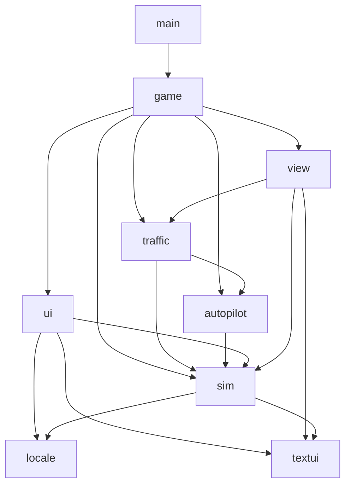

# 项目架构

`main.go` 负责窗口配置、图标和启动。`game` 包负责游戏流程，具体规则和界面由 `internal` 下的包实现。新增功能先按职责选包，避免重新堆入 `game.go`。

## 目录与职责

```text
.
├── main.go                    # Ebitengine 启动入口
├── game/                      # 应用编排：城市切换、输入、路线编辑、运营流程
│   ├── game.go                # Game 状态、构造、Update、Layout
│   ├── city.go                # 城市切换、自定义地图重载
│   ├── planning.go            # 规划模式交互
│   ├── route_lifecycle.go     # 路线变更、公交复位
│   ├── driving.go             # 驾驶帧更新顺序
│   ├── driver_controls.go     # 手动/自动驾驶控制输入
│   ├── driver_input.go        # 驾驶快捷键、HUD 点击
│   ├── driver_safety.go       # 道路边界、玩家自动驾驶死锁恢复
│   ├── stop_approach.go       # 进站判断、飞站、漏站
│   ├── passengers.go          # 上下客、票款、站台交互
│   ├── collisions.go          # 玩家、车队与交通车辆碰撞处理
│   ├── draw.go                # 场景绘制顺序
│   ├── menu.go                # 主菜单与内嵌菜单图标
│   └── assets/                # go:embed 使用的菜单资源
├── internal/
│   ├── sim/                   # 共享仿真状态、物理、地图、路网、信号与交规
│   ├── autopilot/             # 自动驾驶控制器、循迹、换道、进站及避障
│   ├── traffic/               # 社会车辆行为、公交车队、交通死锁恢复
│   ├── view/                  # 地图/车辆/站台/信号灯/路线绘制
│   ├── ui/                    # HUD、仪表盘、设置和规划面板
│   ├── locale/                # 中英文切换与文本选择
│   ├── textui/                # 字体加载、文本绘制与测量
│   └── testutil/              # 测试文件系统隔离
├── tests/integration/         # 跨包运营场景、全地图与发布验收
├── assets/                    # 启动图标、打包资源
├── custom_map.json            # 用户自定义地图，运行时路径保持不变
└── docs/architecture.md
```

## 包依赖



`sim` 不依赖游戏流程、车队控制器、自动驾驶控制器或场景绘制。它提供共享类型，避免地图、车辆与站台互相持有状态时出现循环依赖。路线描述需要文本宽度测量，因此仍使用叶子包 `textui`；渲染实现由 `view` 持有。

绘制函数接收仿真对象，例如 `view.DrawBus(bus, screen, camera)`。修改绘制样式进入 `view`，修改运动/道路/信号规则进入 `sim` 或相应控制器包。

## 大文件的分工

- 地图：`world.go` 管理世界与路网；`maps_roads.go`、`maps_stops.go`、`maps_scenery.go` 组织内置地图数据；`boundaries.go` 管理区域与碰撞边界。
- 路线：`route.go` 管理站点顺序和缓存；`road_graph.go` 处理路网几何；`road_search.go` 执行带朝向的图搜索；`pathfinding.go` 把搜索结果转换为驾驶路径；`roundabout_paths.go` 处理环岛弧线。
- 信号灯：`signals.go` 构建系统；`signal_approaches.go` 处理各方向车道；`signal_phases.go` 维护相位转移；`traffic_rules.go` 判断停车、闯灯与车道违规。
- 社会车辆：`car_update.go` 编排一帧；感知规则分别在 `car_signals.go`、`car_following.go`、`car_roundabout.go`；`car_motion.go` 更新运动和转向；`recovery.go` 处理死锁和重生。
- 自动驾驶：`driver.go` 编排控制；`path.go`、`steering.go`、`speed.go` 分别处理循迹、转向和限速；站台、交叉口、环岛、超车各有明确入口。
- 界面：`hud.go` 处理 HUD 状态和点击；`dashboard.go`、`planning.go`、`settings_draw.go` 负责对应面板。

## 行为与维护约束

1. `Game.Update` 的仿真顺序保持为信号灯、社会车辆、公交车队、交规/碰撞、乘客生成、当前模式输入、相机、HUD。
2. 社会车辆依次应用信号、公交跟车、社会车辆跟车、路口让行、环岛规则，再积分运动。规则可能同时修改刹车标志和当前速度，不能随意调换顺序。
3. 信号灯每帧至多切换一次相位，切换后计时器清零。较大的 `dt` 也不连续跳过多个相位。
4. 图搜索保留节点扫描与相同代价下的选择顺序，以保证缓存重建后的路径稳定。
5. 自动驾驶路径缓存通过 `PrepareLeg`、`InvalidatePath` 和 `PathTargetStopID` 管理，外部代码不访问控制器私有字段。路线描述缓存通过 `InvalidateDescription` 失效。
6. 仿真随机数通过 `sim.RandomIntn`、`sim.RandomFloat64` 和 `sim.SeedSimulation` 共享，拆包不创建独立随机流。

## 测试与开发

单包规则测试与源码同目录，并按功能命名（如 `stations_test.go`、`signals_test.go`）；跨系统场景放在 `tests/integration`。需要访问私有状态的测试留在所属包，不为测试暴露控制器字段。

各测试包的 `TestMain` 使用 `testutil.Run` 把仓库自定义地图复制到独立临时工作目录，确保迁移包目录不改变地图来源，也不会把生成的 JSON 写进源码目录或修改用户地图。

```sh
go test -short ./...   # 日常快速检查
go test ./...          # 包含全地图发布验收
go vet ./...           # 静态检查
go build ./...         # 编译所有包
```

`Makefile` 与 `build.sh` 仍从项目根目录构建启动入口，无需改变启动和打包命令。
