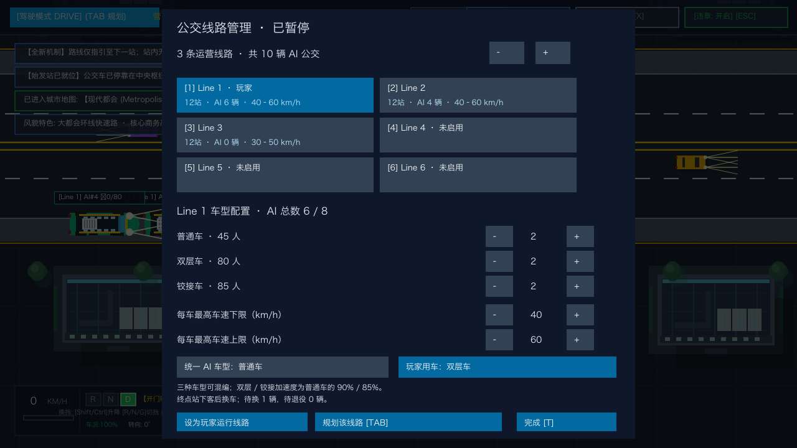
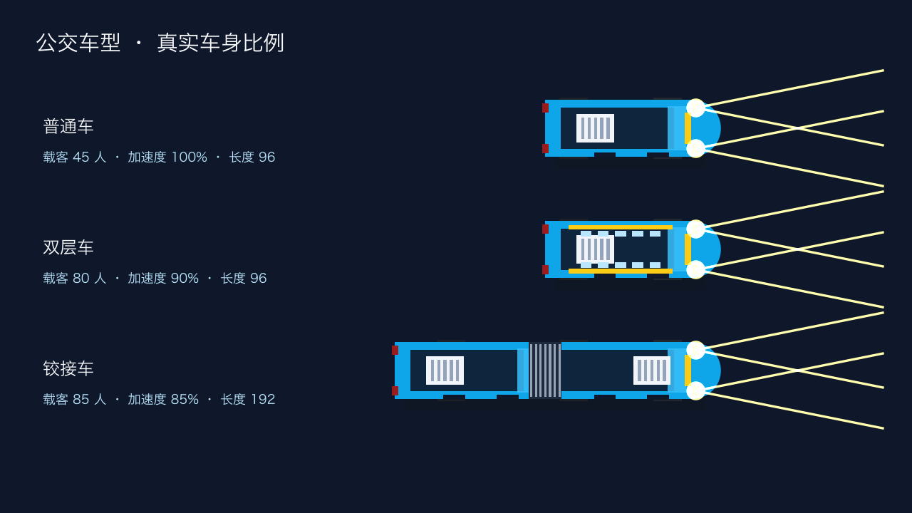
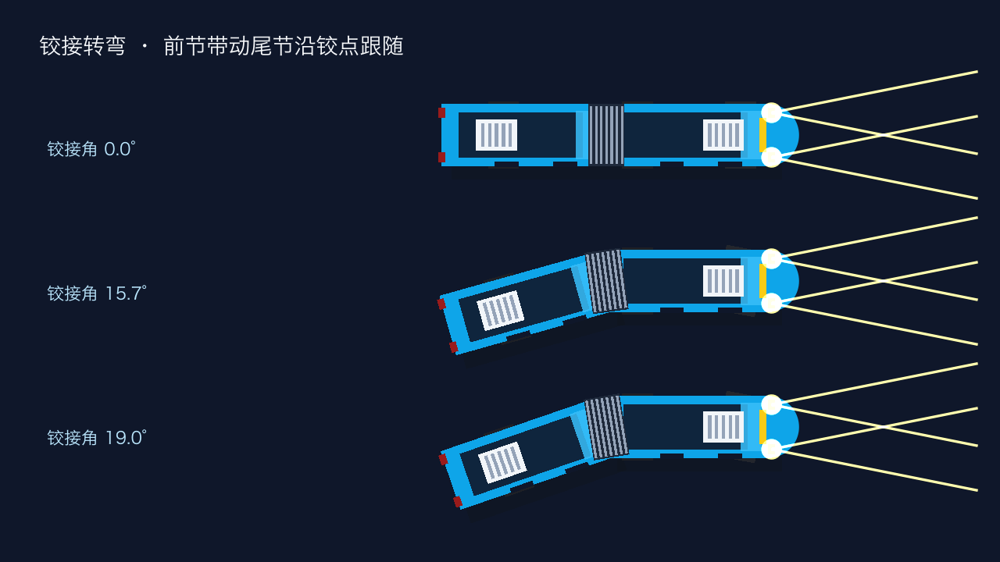

# 公交车型与线路混编（2026-10-23）

按 T 打开线路管理，选择要调整的线路。三种车型各有独立的数量减／加按钮，共享每线 0～8 辆 AI 公交的上限；六条线路仍最多 48 辆。点击「统一 AI 车型」循环选择车型，将该线路现有 AI 数量统一配置为选定车型。「玩家用车」单独决定玩家运行该线路时驾驶的车型。

| 车型 | 载客量 | 基础加速度 | 相对普通车 |
| --- | ---: | ---: | ---: |
| 普通车 | 45 | 230 px/s² | 100% |
| 双层车 | 80 | 207 px/s² | 90% |
| 铰接车 | 85 | 195.5 px/s² | 85% |

限速继续由各线路独立设置。狂暴模式的加速倍率作用于各车型自身的基础加速度。普通车参数保持原值；双层车具有上层窗带，铰接车具有连接波纹外观。

铰接车由两节各 96 px 的车身组成，直行总长 192 px，为普通车的两倍，宽度仍为 36 px。前节使用转向轮车辆模型，尾节车轴遵循无侧滑运动约束，按铰点位移积分其方向；倒车会增大弯折，铰接角限制为 60°，达到限位时停止进一步折叠。转弯后继续直行会逐渐回正。

两节车身各自参与碰撞、道路边界、跟车、变道间隙与扫掠预测。所有站台统一到 336 px（两辆短车或一辆铰接车，详见 [双泊位说明](station-berths-2026-10-23.md)），进出站渐变路径同步加长。终点换成长车前检查完整车身空间；空间不足时旧车保持停车、等待交接，避免尾节直接生成在后车里。

这是适用于俯视游戏的平面车辆运动学模型，未模拟悬挂、轮胎载荷转移或三维侧倾。







## 调整和保存

运营中的换车先记录请求，当前车辆保持原车型、载客量和加速度，完成本圈运营。中途站即使下空乘客也不换车。到路线序列的终点站停车、开门、全部下客后，旧车退出，在同一站位交接新车，再按新车型容量上客。

新车使用完整车况和新的车辆运行状态；线路编号、车队席位及累计营收和已完成圈次保留。待换车期间可以改选目标车型，选择当前车型会取消请求。

混编时减少车型数量，旧车先标记待退役，仍跑完本圈，到终点站下客后退出。随后增加其他车型时，优先把这些仍在路上的席位改为终点站换车请求，避免减一辆、加一辆时在途中消失或立即另派替代车。面板显示计划数量与待换、待退役数量；所有实际在路车辆仍受每线 8 辆的上限约束。退役前的最后一圈与营收会结算保留。

新增加的空闲席位按选定车型调度。切换玩家运营线路仍使用始发站重新调度流程。线路配置、实际车型、待换车型和待退役状态均随 F5/F9 存档保存，读档不会提前触发交接。旧存档缺少车型字段时保持普通车。此前短车身铰接车型保持原尺寸完成当前圈，到终点站再安全换成长车；新存档保存尾节角度和长车路径状态，转弯途中读档不会将尾节拉直。

## 铰接物理专项验证

- 144 种左转、右转、掉头及停靠组合：3 种车道宽度 × 4 种道路车道数 × 4 个朝向 × 3 种转向，全程检查两节车身道路边界；弯折途中经过控制器存档／恢复后继续完成停靠。
- 48 种变道归位组合：普通／狂暴、邻道有车／无车、3 种宽度、4 个朝向，检查尾节避让与两节完全回正。
- 36 种环岛组合，检查进入、绕行、驶出及尾节安全岛避让。
- 实际游戏循环以拥堵档（小车上限 864）、8 辆 AI 铰接车及玩家铰接车、玩家狂暴自动驾驶连续运行 7200 帧（120 秒模拟时间），所有公交车况保持 100%，玩家前进超过 1000 px，各 AI 前进超过 500 px。单独复测通过。运行时间包含并行测试负载，此项不作为帧率基准。
- 铰点连续连接、直行回正、倒车折叠限位及恢复、60／120 Hz 一致性、尾节独立碰撞、长车排队间距。
- 终点站换成长车时前后夹车的等待与空隙释放后恢复；尾节弯折存档恢复、旧短车型延迟迁移。

## 原车型与配车验证

- 车型容量和实际加速模拟，所有车型互换均等待终点站停车、开门和完全下客。
- 混编数量、每线总数上限、车型稳定编号及其他线路状态隔离。
- 调整限速、重置路线、玩家换线后车型配置保持。
- 玩家和系统公交在空车、中途下客、升级和降级时保持原车；终点站交接后按新容量上客。
- 待换和待退役状态的存档往返、改选目标车型与取消请求。
- 混编先减后增时复用待退役席位；待退役车辆在中途继续运营、终点站下客后退出，最后一圈与营收保留。
- 实际游戏中英文线路面板及三种车型渲染检查。
- 铰接车最终完整回归 8537 个通过项（含父测试与子测试），0 失败；5 项可选探针按默认条件跳过。sim、autopilot、traffic 专项及 game 换车／读档专项的竞态检测、go vet、空白检查通过。
- 车型功能引入时，09:46 原始卡死存档以完整游戏更新回放 150 秒通过：完成左转并继续运营至后续站点，车况保持 91%。测试读取临时副本，原存档未修改。
- 已重新编译应用包和独立可执行文件。

```sh
go test ./internal/sim ./internal/traffic ./game -run 'TestBusModel|TestInServiceBus|TestRequestCurrentModel|TestMixedModelFleet|TestLineModels|TestNetworkModel|TestLoadedFleetDowngrade|TestPlayerFinishesLap|TestFleetReplacesOnly|TestMixReduction|TestPendingFleetRetirement|TestRetirementRecordsCompletedLap' -count=1
go test -race ./internal/sim ./internal/autopilot ./internal/traffic -run 'TestArticulated|TestArticulation|TestLongReplacement|TestBusModel|TestInServiceBus|TestRequestCurrentModel|TestMixedModelFleet|TestLineModels|TestNetworkModel|TestLoadedFleetDowngrade|TestPlayerFinishesLap|TestFleetReplacesOnly|TestMixReduction|TestPendingFleetRetirement|TestRetirementRecordsCompletedLap' -count=1
go test -race ./game -run 'TestArticulatedBent|TestPlayerFinishesLap|TestFleetReplacesOnly|TestMixReduction|TestPendingFleetRetirement|TestRetirementRecordsCompletedLap' -count=1
go test ./game -run '^TestArticulatedCityTrafficSoak$' -count=1 -v
go test -json ./... -count=1 -timeout=20m
BUS_REPLAY_SAVE=/tmp/bus-jam-0946.json BUS_REPLAY_TICKS=9000 go test ./game -run '^TestSavedJamReplay$' -count=1 -v
go run ./cmd/bus-model-preview -output /tmp/bus-model-preview
go vet ./...
./build.sh app
```
