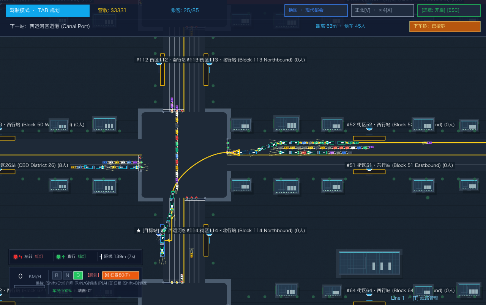

# 2026-10-26 全屏长时间性能测试

后续：[两个连续等待卡点修复与 Metal 编译尖峰归因](wait-slowframe-diagnosis-2026-10-26.md)。本文保留修复前的长测结果。

结论：平均吞吐接近 60 FPS，但仍有可见的偶发慢帧；这轮不能验收为持续满载流畅通过。更明显的发现是车辆长时间等待和车流数量下降。暂不增加第 3、4 项优化，也不能据本次采样证明它们会解决慢帧。

## 配置与测量范围

- M4 MacBook Air，16 GB，Go 1.27.1，Ebitengine 2.10.4，Metal，VSync 开启，默认线程模式。
- 独立全屏测试程序，直接调用当前生产代码的 `Game.Update`、`Game.Draw` 和 `Game.LayoutF`；逻辑画布 1280 × 804，4 倍驾驶视野，种子 5。
- 都会地图，狂暴自动驾驶，48 辆 AI 铰接车加玩家铰接车；初始 864 辆小车。未修改交通规则或增加性能优化。
- 总运行约 930 秒：前 30 秒预热；30–870 秒为 **840 秒无 profiler 主测**；最后 60 秒单独 CPU 采样，不混入主测。
- 主测每秒记录均为全屏、前台状态。使用电池供电，低电量模式关闭；电量约 88% → 81%。系统没有报告温控/性能警告，但未测核心温度或频率，不能证明完全没有降频。
- 采集的是回调墙钟时间及 Draw 开始间隔，**不是 GPU 完成或屏幕实际呈现时间**。每秒 MemStats/进度记录等测量开销仍包含在整体运行中。

## 无 profiler 主测

| 指标 | 结果 |
|---|---:|
| 平均 Update TPS / Draw FPS | 60.00 / 59.78 |
| Update P50 / P95 / P99 / P99.9 | 11.59 / 13.69 / 14.59 / 16.20 ms |
| Update 最大 | 44.76 ms |
| Update > 16.667 / 25 / 33.334 ms | 26 / 5 / 1 次，共 50399 次 |
| Draw 提交 P50 / P99 / 最大 | 1.73 / 2.24 / 4.29 ms |
| Draw 间隔 P99 / P99.9 / 最大 | 17.75 / 34.38 / 161.19 ms |
| Draw 间隔 > 33.334 / 50 / 100 ms | 77 / 16 / 1 次，共 50217 次 |
| GC 次数 / 累计 STW 暂停 | 1449 / 63.75 ms |

最长 Draw 间隔发生在启动后约 **88.61 秒**：从前次 Draw 到下次 Update 开始，中间有约 91.6 ms 没有处于游戏 Update/Draw 回调；随后连续执行了 5 次约 13 ms 的 Update，才再次 Draw。它不是一次 161 ms 的模拟计算，而是回调之外的间隔加上随后补更新。尚不能区分该间隔来自调度、引擎等待、系统或图形后端。

启动后约 **363.09 秒**的最大 Update 为 44.76 ms，也会形成较长 Draw 间隔。这里的 Update 墙钟时间仍可能包含被系统调度挂起的时间，不能全部认定为纯计算。

最慢事件所在的约一秒区间内，记录到的 GC STW 仅约 0.04–0.09 ms，不能用它解释几十至百余毫秒的间隔；这也不能排除 GC 后台工作等其他影响。

## 时间分布

| 启动后时段 | Draw FPS | Update P50 ms | P99 ms | 最大 ms | Draw 间隔 > 33.334 ms |
|---|---:|---:|---:|---:|---:|
| 30–90 s | 59.50 | 13.07 | 15.03 | 19.08 | 4 |
| 90–150 s | 59.03 | 12.46 | 15.64 | 16.43 | 33 |
| 150–210 s | 58.80 | 12.53 | 16.08 | 21.06 | 29 |
| 210–270 s | 59.80 | 12.59 | 14.52 | 26.71 | 4 |
| 270–330 s | 60.02 | 12.85 | 14.31 | 18.91 | 0 |
| 330–390 s | 59.87 | 12.11 | 14.39 | 44.76 | 3 |
| 390–450 s | 59.92 | 11.86 | 14.13 | 30.54 | 4 |
| 450–510 s | 60.02 | 11.33 | 12.74 | 19.07 | 0 |
| 510–570 s | 60.00 | 11.35 | 12.81 | 14.38 | 0 |
| 570–630 s | 59.98 | 10.70 | 12.38 | 14.95 | 0 |
| 630–690 s | 60.02 | 10.64 | 12.13 | 13.77 | 0 |
| 690–750 s | 60.00 | 10.36 | 11.19 | 13.29 | 0 |
| 750–810 s | 60.00 | 10.09 | 11.07 | 17.59 | 0 |
| 810–870 s | 60.00 | 9.66 | 10.42 | 12.88 | 0 |

后半段平均耗时下降不能直接当作热稳定性改善：小车在主测期间为 **680–864 辆**，整轮结束时只剩约 **650 辆**，车队运动量也逐渐减少。15 分钟没有崩溃、进程 RSS 约 200–221 MiB 范围，未见持续内存增长迹象，但这并不是泄漏测试或固定负载热稳定性证明。

## 通行异常

玩家在启动后约 **506.52–929.44 秒**连续每秒行驶距离小于 1 px，持续约 **423 秒**。结束截图中，车在西运河附近路口队列中等待；车队总距离仍有增长，所以不是整个模拟停止。

所有采样中的玩家与 AI 车辆最低耐久均为 100%。这只能说明没有记录到耐久损失，不能证明通行逻辑正确。测试场景长期等待必须单独复现排查，不能给出“发布通行回归通过”。固定种子和设置已保留；未为该合成场景新增存档，也未改写用户存档。

## CPU profile 与补充诊断的限制

最后一分钟 CPU profile 可读，但它给出的 Update/Draw 累计样本占比约 23%/71%，与同一时段约 9.39/1.82 ms 的回调均值明显不一致。原因尚未确认，不据此重新排名 CPU 热点或计算优化收益。这份 profile 本身也来自车辆减少、玩家等待的后期场景。

另尝试了 180 秒 runtime trace 诊断轮。该轮前台状态异常，检查进程时又触发了 macOS System Events 授权弹窗；已终止该查询，没有授予权限。**整轮补充 trace 已排除，不用于性能或调度归因结论。** 主测发生在此前，记录全程前台，没有该弹窗干扰。

## 判断与后续

- 当前平均表现较好，但偶发尖峰仍在。第 3、4 项涉及的几何/碰撞微优化，不能直接解释回调之外的长间隔，因此暂不实施。
- 先处理可复现的长时间排队/等待；同时单独调查回调间隔与补更新放大慢帧的问题。没有把“后段车少、车停住”当作优化收益。
- 若需发布性能验收，还需在通行异常排除后，以实际车数和运动量接近的前台场景再次比较；需要更精确的图形/调度跟踪才能给 161 ms 事件定因。

本轮没有改动任何生产 Go 源文件：438 个已记录文件哈希一致；用户存档哈希一致。只新增报告与忽略目录下的离线测试工具、原始逐帧/环境记录。未重编译或替换发布应用。

原始证据：`dist/performance-fullscreen-2026-10-26/`，包含 `run/events.json`、`run/seconds.json`、环境记录、CPU profile、长测工具源码归档及校验结果。机器可读汇总见同名 JSON。
