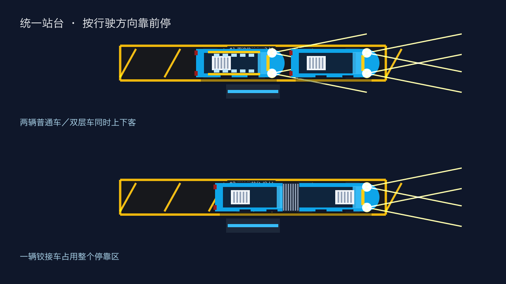

# 统一站台与前后双泊位（2026-10-23）

所有预设地图、自定义地图生成的站台，以及读取旧存档后的站台，统一采用 336 px 长、44 px 宽的停靠区。车头优先对齐行驶方向前方的停车标记，距离停靠区前端 24 px。

- 普通车和双层车共享两个纵向泊位，可混合停靠并同时上下客。前后车保持 24 px 的保险杠间隙。
- 铰接车占用整个停靠区。已有短车停靠时，铰接车在站外等待；铰接车未完全驶离时，后车不能进入站台上下客。
- 第三辆短车在站外排队，不能插到等待中的铰接车前方。
- 两个泊位使用同一个站台客流池，先上车的乘客会扣除，后车继续接走剩余乘客。
- 后泊位车辆上下客期间保持停车，离站路径从其实际位置接入道路。换线、重新规划与新车调度使用前泊位或真实队尾。
- 终点站换成长车前检查整个停靠区。如果另一个泊位仍有短车，保留待换请求继续运营，下一次终点站有空间时再交接，避免前车等待换车反而困住后车。

狂暴模式既有的道路侧停靠能力仍保留，道路侧停靠也使用前方标记；站台内部优先选择前、后泊位。

## 存档兼容

升级站台尺寸不会移动正在运行或上下客的公交。两个泊位的车辆位置、开门状态与上下客进度可独立恢复。旧的行驶路径保留已进入的转弯，下一个安全阶段或下一路段使用新的前方停车目标。

## 验证范围

- 36 种车型组合与朝向的调度排队：两辆普通／双层可进站，铰接车独占，第三辆车保持站外，完整车身无重叠。
- 36 种行驶进站组合：后泊位可与前车同时停靠；等待长车／短车清空后恢复进站；检查路缘与两节车身碰撞。
- 六张地图、三种车道宽度的站台规格统一。
- 两辆短车同时上下客，100 位候车乘客分别登上普通车和双层车，合计仍为 100 位。
- 终点换车与后泊位退出、两泊位存档恢复、旧短站台存档升级。
- 原有共站排队、全地图连续运营、右转、掉头、环岛、窄路及邻车避让回归。
- 专项竞态检测、`go vet ./...`、空白检查，以及 macOS 应用构建。

停靠扫掠先筛掉距离之外的车辆，每个预测点只计算一次铰接尾节，再复用于邻车检查。

## 最终验证结果

- `go test -json ./... -count=1 -timeout=20m` 全部通过：8,691 项测试及子测试通过，5 项跳过，0 项失败。
- 864 辆小车、8 辆 AI 铰接车及玩家铰接车运行 7,200 帧（120 秒仿真）：全部公交耐久度保持 100，玩家位移超过 1,000 px，每辆 AI 位移超过 500 px。此项检查仿真进展与碰撞，不作为渲染帧率结论。
- 站台、排队、换车与存档相关专项 `-race` 检测通过，`go vet ./...` 与 `git diff --check` 通过。
- 使用本地 13:05 存档的临时副本验证旧站台升级，并继续运行 300 帧，通过；未覆盖用户存档。
- `./build.sh app` 成功生成 `busgame` 与 `2D Bus Simulator.app`。
